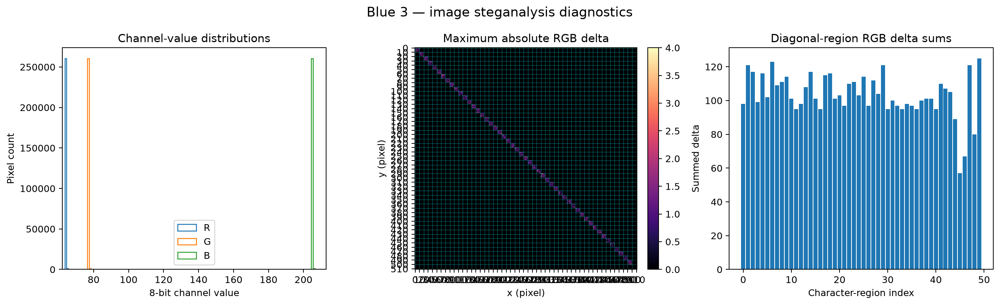
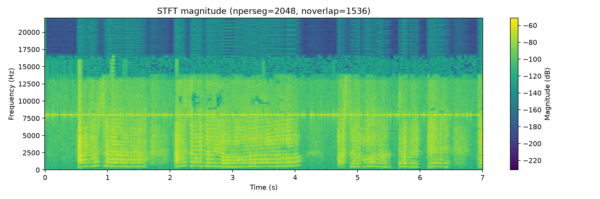

# BÁO CÁO ĐỒ ÁN THỰC HÀNH CTF JEOPARDY
## UET.CN3124 — An toàn và an ninh mạng

**Tên đề tài:** Phân tích và đánh giá kỹ thuật ẩn tin trên ảnh và âm thanh qua Blue 3 (BYUCTF) và Sleepy Alarm (ImaginaryCTF 2024)  
**Chủ đề CTF chính:** Steganography  
**Sinh viên:** ______________________________ — **MSSV:** __________________  
**Lớp:** __________________ — **Ngày nộp:** ____ / ____ / 2026 — **Hạn nộp:** ____ / ____ / 2026

> **Sidenote hành chính:** Các trường thông tin cá nhân trên trang bìa hiện chưa được điền trong repository. Theo phạm vi rà soát kỹ thuật hiện tại, các trường này được xem là phần hành chính cần bổ sung khi xuất bản nộp bài, không dùng để đánh giá mức độ hoàn thành kỹ thuật của đồ án.

> **Trạng thái bằng chứng:** Blue 3 và Sleepy Alarm đều đã được giải từ artifact chính thức, đối chiếu với ground truth của ban tổ chức. Sleepy Alarm khôi phục đúng 39 ký tự, 350 symbol và 38 separator; sáu regression tests pass. Thí nghiệm robustness Blue 3 và bốn thí nghiệm audio theo cặp target/reference đã có kết quả đo trong results/. Nhật ký thời lượng làm việc cá nhân vẫn cần được người thực hiện điền theo thời gian thực tế.

---

## Tóm tắt

Đồ án khảo sát hai cơ chế steganography khác nhau trong cùng một chủ đề CTF. Blue 3 (BYUCTF) ẩn từng ký tự trong tổng sai khác giá trị RGB của các vùng vuông nằm trên đường chéo ảnh. Sleepy Alarm (ImaginaryCTF 2024) nhúng chuỗi bit bằng điều chế biên độ ASK trên sóng mang 8 kHz, tốc độ 50 baud, rồi trộn tín hiệu này vào bản nhạc báo thức.

Đối với Blue 3, công cụ tự viết phân tích ảnh PNG 512 × 512, suy luận màu nền RGB (64, 77, 205), thử 49 độ dài ứng viên và khôi phục chính xác flag 50 ký tự. Đối với Sleepy Alarm, decoder căn chỉnh hai MP3 bằng cross-correlation, bảo toàn prefix chưa chồng lấp, phân tích kênh trái và dùng coherent sine/cosine projection trên từng cửa sổ 882 mẫu. Kết quả trên MP3 chính thức gồm 350 symbol, 38 separator, 39 byte và chuỗi 39 ký tự trùng toàn bộ bitmap ground truth của creator. Bốn thí nghiệm audio robustness theo cặp target/reference đều khôi phục chính xác thông điệp; trong sáu phép biến đổi bất đối xứng, ba phép PASS và ba phép FAIL.

Đóng góp của đồ án gồm decoder Blue 3 có chế độ tự suy luận màu nền, decoder ASK có căn chỉnh tham chiếu và xác minh exact-match, công cụ tạo hình phân tích ảnh/âm thanh, bộ kiểm thử hồi quy tổng hợp, workflow CI chạy trên artifact chính thức và kịch bản thí nghiệm độ bền. Báo cáo phân biệt kết quả đo được, kết quả tham khảo từ source upstream và các thí nghiệm chưa thực hiện.

**Từ khóa:** Steganography, Steganalysis, CTF, pixel-difference encoding, Amplitude Shift Keying, FFT, STFT, cross-correlation.

## 1. Giới thiệu và thiết kế đồ án

### 1.1. Bối cảnh và mục tiêu

Steganography tập trung che giấu sự tồn tại của thông điệp trong một vật mang tin, chẳng hạn ảnh hoặc âm thanh. Khác với mật mã học, mục tiêu không chỉ là làm cho nội dung khó đọc mà còn làm cho người quan sát khó nhận ra có dữ liệu bổ sung. Người gửi cần nhúng thông điệp sao cho ít gây nghi ngờ; người phân tích cần nhận biết bất thường và khôi phục thông điệp khi có đủ bằng chứng.

Đồ án chọn hai challenge sử dụng hai loại vật mang tin khác nhau. Blue 3 thể hiện cách nhúng dữ liệu trong miền không gian của ảnh, còn Sleepy Alarm thể hiện cách nhúng trong miền tín hiệu của âm thanh. Cặp challenge này cho phép so sánh hai hướng phân tích: thống kê pixel theo vùng và phân tích tín hiệu theo tần số/thời gian.

Mục tiêu cụ thể:
1. Tái hiện hai challenge bằng artifact chính thức, giữ nguyên dữ liệu đầu vào và ghi SHA-256.
2. Tự xây dựng decoder thay vì chỉ sử dụng lời giải có sẵn.
3. Phân tích điều kiện toán học khiến decoder hoạt động và điều kiện khiến nó thất bại.
4. So sánh cách giải có thông tin từ source với cách giải dựa trên artifact.
5. Tạo thí nghiệm kiểm tra độ nhạy của kỹ thuật nhúng trước một số phép biến đổi.
6. Đánh giá dấu hiệu phát hiện và biện pháp phòng thủ đối với ảnh/âm thanh có dữ liệu ẩn.

### 1.2. Lý do lựa chọn và so sánh phương án

Assignment yêu cầu chọn một chủ đề CTF chính và khuyến nghị một cụm challenge nhất quán gồm hai challenge có liên hệ, hoặc một challenge khó kèm phần mở rộng có ý nghĩa [10]. Hai challenge được chọn đều thuộc hướng steganography, nhưng bổ sung cho nhau về dữ liệu và công cụ.

| Phương án | Cơ chế và giá trị nghiên cứu | Lý do chọn / không chọn |
|---|---|---|
| **Blue 3 — BYUCTF (chọn)** | Tổng sai khác RGB theo vùng chéo; tự suy luận và viết decoder | Có artifact, creator source và solver tham khảo; cho phép đối chiếu white-box/black-box |
| **Sleepy Alarm — ImaginaryCTF (chọn)** | ASK 8 kHz trong audio; phân tích phổ, đồng bộ và khôi phục symbol | Bổ sung miền tín hiệu khác với ảnh; có source tạo tín hiệu và track gốc để kiểm chứng |
| Bài ảnh LSB phổ thông (không chọn) | Đọc bit thấp của kênh màu; dễ tái hiện | Ít chiều sâu nếu chỉ chạy công cụ; cần phần mở rộng riêng |
| Steghide (không chọn) | Trích payload bằng công cụ đóng gói | Phụ thuộc passphrase/công cụ; khó so sánh thuật toán nếu thiếu source hoặc biến thể |

Blue 3 được ưu tiên vì source mô tả thuật toán cụ thể, ảnh đầu vào có sẵn và có thể tự kiểm tra từ dữ liệu. Sleepy Alarm bổ sung một bài toán tín hiệu khác hẳn, đồng thời tạo điều kiện phân tích sự khác nhau giữa dữ liệu gốc, tín hiệu đã trộn và tín hiệu sau nén MP3. Việc chọn hai bài không nhằm tăng số lượng flag mà nhằm tạo phép so sánh có cùng chủ đề nhưng khác miền biểu diễn.

### 1.3. Đối chiếu với các repository mã nguồn mở

Để xác định vị trí của đồ án trong hệ sinh thái công cụ hiện có, báo cáo khảo sát README và tài liệu công khai của ba repository liên quan. Đây là đối chiếu phạm vi/chức năng trên tài liệu, **không phải benchmark**: các repository bên ngoài không được cài đặt hoặc chạy trên cùng bộ dữ liệu trong đồ án này.

| Repository | Phạm vi được mô tả công khai | Hàm ý đối với STEGO |
|---|---|---|
| **Aperi'Solve** [11] | Nền tảng steganalysis ảnh; trực quan hóa bit-plane theo kênh R/G/B/Alpha và tích hợp zsteg, steghide, outguess, exiftool, binwalk, foremost, pngcheck, strings | Forensic ảnh thực tế cần nhiều detector độc lập; decoder Blue 3 chuyên biệt không thay thế pipeline đa công cụ |
| **The-A-Files** [12] | Framework đánh giá audio steganography/watermarking; README mô tả 30 phương pháp, 26 nhóm attack và 25 metric, tách payload recovery, chất lượng tín hiệu, robustness, capacity và detectability | Đánh giá robustness nên bao phủ nhiều phép biến đổi và metric, không chỉ exact-match |
| **ragibson/Steganography** [13] | Cài đặt LSB cho BMP/PNG, WAV và byte sequence; có LSB steganalysis đơn giản cho ảnh bitmap | Detector theo họ LSB không mặc nhiên giải được phép tổng sai khác RGB của Blue 3 hoặc ASK của Sleepy Alarm |

Đối chiếu này cho thấy đóng góp phù hợp của STEGO là nghiên cứu tái hiện có kiểm soát trên hai challenge: giải thích cơ chế, tự triển khai decoder, giữ lại lỗi trung gian và lưu bằng chứng có thể tái chạy. Khoảng trống so với các framework rộng hơn nằm ở số họ thuật toán, quy mô corpus, detector, metric chất lượng và độ đa dạng của attack. Không có cơ sở để tuyên bố STEGO vượt trội các dự án trên khi chưa có benchmark trực tiếp.

### 1.4. Câu hỏi nghiên cứu và giả thuyết

- **RQ1:** Tổng sai khác RGB theo từng vùng có đủ thông tin để khôi phục ký tự đã nhúng trong Blue 3 hay không?
- **RQ2:** Phân tích phổ và envelope có thể tách tín hiệu ASK 8 kHz khỏi âm thanh nền trong Sleepy Alarm hay không?
- **RQ3:** Kết quả giải mã thay đổi thế nào khi ảnh bị JPEG recompression/resize hoặc âm thanh bị resampling/gain/clipping?
- **RQ4:** Có thể xây dựng dấu hiệu phát hiện steganography từ đặc trưng pixel và phổ âm thanh không?

Các giả thuyết:
- **H1 — Blue 3:** Nếu màu nền được xác định đúng, ảnh còn nguyên vẹn và kích thước không thay đổi, tổng chênh lệch ba kênh RGB trong vùng ký tự thứ i bằng mã ASCII của ký tự đó.
- **H2 — Sleepy Alarm:** Nếu tách được thành phần quanh 8 kHz, giữ đúng đồng hồ symbol 50 baud và phân biệt được ba trạng thái biên độ, có thể phục hồi 350 symbol tương ứng 39 byte và 38 dấu phân cách.
- **H3 — Độ bền:** JPEG recompression/resize có thể phá hủy quan hệ pixel tuyệt đối của Blue 3; resampling, filtering hoặc clipping có thể làm sai biên độ/thời điểm symbol của Sleepy Alarm.

### 1.5. Tiêu chí xác nhận thành công

| Challenge | Điều kiện xác nhận | Kết quả đã đo |
|---|---|---|
| Blue 3 | Khôi phục flag, đối chiếu nguồn chính thức, ghi hash và thông số ảnh | Đạt: flag 50 ký tự; 49 độ dài ứng viên; PNG RGB 512 × 512 |
| Sleepy Alarm | 350 symbol, 38 separator, 39 byte; không byte lỗi; exact-match ground truth | Đạt: 39/39 ký tự; prefix/suffix hợp lệ; errors rỗng; ground_truth_match=true |
| Robustness | Chạy decoder trên biến thể và ghi tham số | Đạt trong phạm vi đã thử: 5 biến thể ảnh; 4/4 phép audio theo cặp target/reference PASS; thí nghiệm bất đối xứng có 3/6 phép thử PASS và 3/6 FAIL |

### 1.6. Liên hệ trực tiếp với rubric

| Tiêu chí | Điểm tối đa | Minh chứng chính |
|---|---:|---|
| Lập kế hoạch và biện minh | 2,0 | Mục 1: RQ/H1–H3, so sánh phương án, lý do chọn hai challenge cùng chủ đề |
| Triển khai và tài liệu hóa | 4,0 | Mục 3–8: artifact và SHA-256, lệnh, decoder, 6 regression tests, hình và CSV/JSON CI |
| Phân tích kết quả | 2,0 | Mục 2, 5, 6, 9, 10: chứng minh toán học, 350 symbol ASK, lỗi và điều kiện giải |
| Đánh giá, phản biện và tự học | 2,0 | Mục 11: giới hạn reference-assisted, false positives, robustness và logbook cá nhân |

Bảng này là bản đồ đối chiếu với rubric, không phải tự chấm điểm. Điểm số chỉ do giảng viên quyết định dựa trên báo cáo và khả năng trình diễn lại.

## 2. Kiến thức nền và mô hình kỹ thuật

### 2.1. Mô hình steganography

Có thể mô tả quá trình nhúng tổng quát:

**Mô hình nhúng:** `S = E(C, M, K, θ)`. Trong đó `C` là vật mang tin, `M` là thông điệp, `K` là khóa (nếu có), `θ` là bộ tham số và `S` là vật mang tin sau khi nhúng.

Quá trình trích xuất tìm:

**Mô hình trích xuất:** `M_hat = D(S, K, θ)`. Decoder nhận vật mang tin đã nhúng và khôi phục thông điệp ước lượng.

Một kỹ thuật ẩn tin thường được đánh giá qua ba yếu tố: dung lượng (payload capacity), tính khó phát hiện (imperceptibility) và độ bền (robustness). Ba yếu tố này có thể xung đột. Ví dụ, thay đổi nhiều pixel có thể tăng dung lượng nhưng làm phân bố màu dễ bị phát hiện; nén ảnh có thể phá hủy payload.

### 2.2. Blue 3: mã hóa bằng tổng sai khác RGB

Theo README và creator script chính thức, ảnh được tạo từ nền đồng nhất RGB = (64, 77, 205), kích thước 512 × 512. Với flag có độ dài L, đặt:

**Kích thước cạnh vùng:** `s = floor(512 / L)`, với `L` là độ dài flag.

Ký tự thứ i được gắn với vùng vuông:

**Vùng của ký tự thứ i:** `R_i = [i·s, (i+1)·s) × [i·s, (i+1)·s)`.

Trong mỗi vòng lặp tương ứng một đơn vị mã ký tự, creator chọn ngẫu nhiên một pixel thuộc R_i và tăng một đơn vị ở một trong ba kênh RGB. Nếu pixel được chọn nhiều lần, các mức tăng được cộng dồn.

Gọi B=(64,77,205) là màu nền và I(x,y,c) là giá trị kênh c tại pixel (x,y). Tổng sai khác của vùng i:

**Tổng sai khác RGB của vùng i:** `Δ_i = Σ_(x,y)∈R_i Σ_(c∈{R,G,B}) (I(x,y,c) − B_c)`, trong đó `B=(64,77,205)` là màu nền.

Mỗi thao tác nhúng chỉ tăng đúng một đơn vị ở đúng một kênh. Do đó, nếu ảnh không bị biến đổi và không xảy ra tràn/clipping giá trị kênh:

**Quan hệ mã hóa:** `Δ_i = ord(m_i)`, vì mỗi đơn vị mã ký tự làm tăng đúng một đơn vị ở một kênh RGB trong vùng.

Suy ra ký tự:

**Khôi phục ký tự:** `m_hat_i = chr(Δ_i)`.

Phép tổng hợp không cần biết pixel nào đã bị thay đổi, kênh nào được chọn hay thứ tự ngẫu nhiên của creator. Các thao tác tăng một đơn vị có tính cộng, nên tổng sai khác giữ lại số lần tăng của cả vùng. Điều kiện thành công là xác định đúng L, đúng màu nền, đúng ranh giới vùng và bảo toàn giá trị pixel.

Với flag thực tế có 50 ký tự, s = floor(512/50) = 10. Mỗi ký tự tương ứng vùng 10 × 10 pixel; 50 vùng bao phủ 5.000 vị trí pixel trên đường chéo. Mép phải và mép dưới còn 12 pixel không thuộc các vùng được duyệt. Tổng số lần tăng kênh suy ra từ chuỗi flag chính thức là 5.164; số lần tăng có thể lớn hơn số vị trí pixel vì một pixel có thể được chọn lặp lại.

### 2.3. Sleepy Alarm: điều chế ASK trong miền thời gian

Source MATLAB của challenge mô tả ba trạng thái biên độ:
- 0: dấu phân cách/kết thúc một byte.
- 2 × 10⁻³: bit 0.
- 5 × 10⁻³: bit 1.

Sóng mang có tần số fc = 8.000 Hz. Tốc độ symbol Rs = 50 baud, nên thời lượng mỗi symbol Ts = 1/Rs = 0,02 giây. Với sample rate 44.100 Hz, số mẫu mỗi symbol là:

**Số mẫu trên mỗi symbol:** `N_s = f_s × T_s = 44,100 × 0.02 = 882 samples`.

Một ký tự ASCII gồm 8 bit. Flag dài 39 ký tự nên có 312 bit. Generator chèn một dấu phân cách giữa các byte, tạo 38 dấu phân cách. Tổng số symbol là:

**Tổng symbol:** `N_symbol = 39 × 8 + 38 = 350`, gồm 312 bit dữ liệu và 38 dấu phân cách.

350 symbol × 0,02 giây = 7 giây. Trong mỗi symbol, sóng mang có 8.000 × 0,02 = 160 chu kỳ. Generator MATLAB cộng tín hiệu ASK vào cột thứ nhất của ma trận audio, tức kênh trái trong file stereo. Vì vậy, lấy trung bình hai kênh trước khi giải mã sẽ làm suy giảm biên độ thành phần ASK.

### 2.4. FFT, STFT và envelope

Biến đổi Fourier rời rạc:

**DFT:** `X[k] = Σ_(n=0)^(N−1) x[n] · exp(−j·2π·k·n/N)`. Độ phân giải tần số là `Δf = f_s / N`. FFT trên toàn file phù hợp để xác định peak tần số nhưng không cho biết peak xuất hiện ở thời điểm nào. STFT chia tín hiệu thành các cửa sổ ngắn; spectrogram biểu diễn năng lượng theo thời gian và tần số. Sau khi lọc băng quanh sóng mang, analytic signal/Hilbert transform có thể dùng để lấy envelope, từ đó ước lượng mức biên độ trong phần giữa mỗi symbol.

Đối với Sleepy Alarm, các tham số quan trọng là tần số cắt bộ lọc, kích thước cửa sổ STFT, hop length, vị trí bắt đầu symbol và cách xử lý âm thanh nền. Spectrogram không phải bằng chứng duy nhất; kết luận phải phù hợp với số symbol, mức biên độ, cấu trúc byte và độ dài flag được challenge gợi ý.

## 3. Nguồn dữ liệu và tính toàn vẹn

Các artifact được lấy từ repository chính thức, tải về bằng script có kiểm tra kích thước và tính SHA-256 cục bộ.

- **Blue 3 — blue.png:** 9.406 bytes; SHA-256 `009dab85bf6ccc5b42b8efa5f959ab6efa0c556b37eb6b4a77a21ec3356b721e`.
- **Sleepy Alarm — morning_n_breakfast.mp3:** 179.283 bytes; SHA-256 `bd181876c2d28152b9c3982fd88945d4e681fd93d49477622ea5841a3ff25ae2`.
- **Track tham chiếu — morning_n_breakfast_original.mp3:** 160.495 bytes; SHA-256 `d0c283834955e54d68b0bba723ccd194142a428d2de74722e5f1dff3ccbd94ad2`.

Ba artifact chính thức được lưu nguyên bản trong data/; nguồn và commit upstream được liệt kê tại [1]–[5].

Blue 3 có định dạng PNG, mode RGB, kích thước 512 × 512, 262.144 pixel; Pillow không báo metadata key. Các giá trị kênh quan sát được:

| Kênh | Miền giá trị | Mean ± Std | Số giá trị |
|---|---:|---:|---:|
| R | 64–68 | 64,006634 ± 0,093454 | 5 |
| G | 77–81 | 77,006531 ± 0,094254 | 5 |
| B | 205–209 | 205,006535 ± 0,094233 | 5 |

Các giá trị min/max nhất quán với mô hình nền (64,77,205) được tăng từng đơn vị. Tuy nhiên, chỉ các thống kê này chưa đủ chứng minh payload; bằng chứng quyết định là tổng sai khác theo đúng phân vùng và kết quả giải mã đối chiếu với flag chính thức.

## 4. Môi trường thực nghiệm và công cụ

### 4.1. Cấu hình ghi nhận từ máy chạy

| Thành phần | Phiên bản/cấu hình |
|---|---|
| Hệ điều hành | macOS 15.7.4 |
| Kiến trúc | arm64 |
| Python | 3.14.10 |
| Pillow | 13.0.0 |
| NumPy | 2.5.4 |
| SciPy | 1.18.1 |
| Matplotlib | 3.11.2 |
| SoundFile | 0.14.0 |
| Quản lý môi trường | uv và virtual environment .venv |

Pillow đọc ảnh và trích ma trận RGB; NumPy tính tổng và thống kê mảng; SciPy thực hiện lọc, cross-correlation và STFT; SoundFile đọc dữ liệu audio; Matplotlib xuất histogram, waveform, spectrogram và envelope.

### 4.2. Cài đặt và tái lập

~~~bash
uv venv --python 3.14
source .venv/bin/activate
uv pip install -r requirements.txt
python scripts/check_environment.py
python scripts/download_artifacts.py all
python -m unittest discover -s tests -v
~~~

Không chỉnh sửa artifact gốc. Mọi ảnh JPEG, ảnh resize, audio resample hoặc audio gain/clipping phải được lưu trong thư mục kết quả riêng. Trước mỗi lần chạy, ghi lại hash input, lệnh, tham số và thời gian chạy.

## 5. Quy trình thực hiện và kết quả Blue 3

### 5.1. Khảo sát ban đầu

Lệnh chạy:

~~~bash
python src/blue3/analyze.py data/blue3/blue.png
~~~

Kết quả cho thấy PNG RGB 512 × 512, không có metadata key và các kênh chỉ sử dụng 5 mức giá trị nằm sát màu nền. Đây là chỉ dấu phù hợp với một phép biến đổi pixel có biên độ nhỏ. Giả thuyết được đặt ra là tổng độ lệch của từng vùng đường chéo có thể biểu diễn mã ký tự.

### 5.2. Decoder và tìm độ dài flag

Lệnh chạy:

~~~bash
python src/solve_challenges.py blue3 data/blue3/blue.png
~~~

Trong lần chạy đầu, decoder sử dụng màu nền RGB (64,77,205), thử các độ dài ứng viên và cộng tổng sai khác RGB của mỗi vùng. Kết quả terminal:

~~~text
Candidate: byuctf{more_blue_steganography_da_ba_dee_nkiY9CyP}
Attempts: 49
Format validated: True
~~~

Chuỗi có 50 ký tự và trùng chính xác với flag trong README chính thức của BYU-CSA [1]. Đây là xác minh độc lập ở mức kết quả: decoder khôi phục từ pixel, sau đó được so sánh với giá trị do ban tổ chức công bố. Việc khớp regex đơn thuần sẽ yếu hơn vì có thể xuất hiện ứng viên ngẫu nhiên; đối chiếu với flag chính thức làm giảm đáng kể khả năng kết luận nhầm.

### 5.3. Tự triển khai và so sánh hai cách xác định màu nền

Creator source công bố màu nền RGB (64,77,205). Tuy nhiên, để tránh phụ thuộc vào thông tin source khi giải hard-mode chỉ cung cấp ảnh, decoder mới có hai cách:
1. **Black-box:** suy luận màu nền là bộ RGB xuất hiện phổ biến nhất trong ảnh.
2. **Source-informed:** truyền trực tiếp màu nền biết từ creator source qua tham số.

Phiên bản hiện tại đặt black-box làm mặc định. Lần chạy black-box trên PNG chính thức đã khôi phục cùng flag sau 49 ứng viên; log được lưu tại `results/logs/blue3-solver.log`. Chế độ source-informed được giữ làm đối chứng để tách biệt lợi ích của thông tin creator với suy luận chỉ dựa trên artifact.

### 5.4. Độ phức tạp và điều kiện thành công

Với mỗi ứng viên L, tổng số pixel được xét trên L vùng xấp xỉ L × (512/L)² = 512²/L. Khi thử nhiều độ dài, tổng lượng công việc tăng theo O(n² log n) trong trường hợp tổng quát. Bộ nhớ chính để giữ ma trận ảnh là O(n²). Với ảnh 512 × 512, phép tính nhẹ và phù hợp máy cá nhân.

Các điều kiện cần:
- Dữ liệu ảnh còn nguyên giá trị pixel, không bị JPEG recompression hoặc resize.
- Kích thước và hình học vùng còn đúng 512 × 512.
- Màu nền được xác định chính xác.
- Creator chỉ tăng giá trị kênh; không có phép biến đổi làm đổi dấu/số lượng sai khác.
- Độ dài L được xác định đúng.

### 5.5. Hình phân tích ảnh

Hình 1 được tạo trực tiếp từ `blue.png` bằng script `src/blue3/visualize.py`. Ba panel lần lượt biểu diễn phân bố giá trị RGB, heatmap độ lệch lớn nhất giữa pixel và màu nền (64,77,205), và tổng sai khác RGB trong từng vùng chéo. Biểu đồ vùng là bằng chứng trực quan bổ sung cho decoder: nếu giả thuyết đúng, các tổng vùng phải tương ứng với mã ký tự và không cần xác định từng pixel bị thay đổi.

Lệnh tái hiện:

~~~bash
python src/blue3/visualize.py data/blue3/blue.png --length 50 --out-dir results/blue3/figures
~~~

## 6. Quy trình và kết quả Sleepy Alarm

### 6.1. Khảo sát và xác định cơ chế

Challenge mô tả một jingle yếu trong file báo thức. Source README chỉ ra peak khác thường ở 8 kHz và ba mức biên độ sau khi cô lập sóng mang. Source MATLAB xác định payload 350 symbol, 50 baud, thời gian truyền 7 giây và việc cộng tín hiệu ASK vào kênh audio đầu tiên [4][5].

Các file MP3 được tải và xác minh SHA-256. Lần phân tích đầu tiên với reference báo lỗi do hai file sau giải mã không có cùng số frame. Module audio_alignment được bổ sung để chuyển đổi sample rate khi cần, ước lượng offset bằng cross-correlation và chỉ trừ phần hai tín hiệu chồng lấp.

### 6.2. Lần giải mã đầu tiên — kết quả thất bại được giữ lại

Lần chạy solver đầu tiên với reference ghi nhận:

| Thông số | Giá trị |
|---|---:|
| Sample rate | 44.100 Hz |
| Số kênh | 2 |
| Thời lượng phần overlap | 9,952653 s |
| Alignment lag | 1.729 samples |
| Alignment lag theo thời gian | 0,039206 s |
| Số frame overlap | 438.912 |
| Normalized absolute correlation | 0,9998734 |
| Symbol đã xử lý | 497 |
| Separator bị nhận diện | 161 |
| Unknown symbol | 0 |
| Khoảng envelope median | 0,0000312 đến 0,0030983 |
| Byte NUL thu được | 17 |
| Nhóm bit không đủ 8 bit | 18 |

Solver trả về chuỗi NUL và các nhóm bit có độ dài không hợp lệ. Đây là **kết quả thất bại**, không phải flag. Việc giữ lại lần thất bại có giá trị vì nó cho thấy độ tương quan cao giữa hai soundtrack không đồng nghĩa decoder đã lấy đúng payload. Cross-correlation chỉ hỗ trợ căn chỉnh nền âm thanh; nó không tự chứng minh biên symbol hoặc biên độ đã được nhận dạng đúng.

### 6.3. Phân tích nguyên nhân

Lần triển khai cũ mắc ba vấn đề kỹ thuật:
1. **Trung bình hai kênh stereo:** generator chỉ thêm ASK vào channel 0. Việc lấy trung bình hai kênh làm giảm thành phần ASK và thay đổi phân bố envelope.
2. **Xử lý cả file thay vì payload:** file dài gần 10 giây nhưng generator chỉ tạo chuỗi ASK 7 giây. Vì vậy, lần chạy cũ xử lý 497 symbol thay vì 350.
3. **Ngưỡng cố định chưa phù hợp:** ngưỡng 0,002 và 0,005 được mô tả trong source generator, nhưng tín hiệu đã qua MP3 encoding và bước lấy envelope. Dùng trực tiếp các ngưỡng này sau khi trộn/trừ audio có thể phân loại sai.

### 6.4. Phiên bản decoder đã điều chỉnh

Phiên bản hiện tại của solver và analyzer thực hiện quy trình:
1. Đọc hai MP3, resample reference nếu sample rate khác; ước lượng offset bằng cross-correlation và chỉ lấy phần overlap.
2. Giữ prefix của distributed MP3 trước điểm bắt đầu overlap rồi ghép với residual. Prefix này có thể chứa các symbol ASK đầu tiên; bỏ nó làm mất bit đầu.
3. Phân tích channel 0 (left), vì creator chỉ chèn ASK vào kênh thứ nhất.
4. Dùng coherent detection: chiếu từng cửa sổ 882 mẫu lên hai cơ sở sin/cos 8 kHz và tính biên độ I/Q. Mỗi symbol có 160 chu kỳ sóng mang; phép chiếu toàn symbol tránh transient ở đầu chuỗi của Hilbert-envelope sau lọc.
5. Phân cụm ba mức thấp/trung bình/cao thành separator/bit 0/bit 1; nhóm 8 bit thành byte.
6. Kiểm tra 350 symbol, 38 separator, 39 byte, độ dài 39 và đối chiếu toàn bộ chuỗi với ground truth được đọc độc lập từ bitmap creator.

Một lần chạy đầu tiên dùng Hilbert-envelope và xử lý cả file đã thất bại; log được giữ tại results/2026-11-14/initial-run.md. Sau khi sửa đúng kênh, cửa sổ payload, prefix alignment và phép đo biên độ, decoder mới đã exact-match trên MP3 phân phối.

Việc đối chiếu chính xác toàn bộ chuỗi là điều kiện bắt buộc để `success=true`. Chỉ khớp prefix/suffix không được xem là giải thành công.

### 6.5. Kết quả giải mã trên MP3 chính thức

Phiên bản coherent detector đã chạy trên file phân phối và so sánh với ground truth được đọc độc lập từ bitmap trong createsignal.m. Output đầy đủ được lưu trong results/sleepy_alarm/solver.json.

| Đại lượng | Kết quả |
|---|---:|
| Sample rate / kênh phân tích | 44.100 Hz / channel 0 (left) |
| Alignment lag | 1.729 mẫu = 0,039206 s |
| Normalized absolute correlation | 0,9998734 |
| Prefix được giữ trước overlap | 1.729 mẫu |
| Symbol đã giải | 350/350 |
| Separator / bit 0 / bit 1 | 38 / 153 / 159 |
| Tâm cụm biên độ | 0,0001035 / 0,0019975 / 0,0049727 |
| Byte giải mã / byte lỗi | 39 / 0 |
| Exact-match | PASS |

Tâm cụm bit 0 và bit 1 lệch lần lượt khoảng −0,13% và −0,55% so với mức danh định 0,002 và 0,005. Cụm separator ở khoảng 0,0001035 phản ánh nhiễu/codec còn lại sau phép trừ tham chiếu.

**Chuỗi trích xuất từ MP3:** ictf{1_sl33py_NaYuKi_alarm_2a634dc1bb2}. Chuỗi 39 ký tự khớp toàn bộ bitmap ground truth của creator; errors=[]; format_valid=true; ground_truth_match=true. Ground truth chỉ được dùng sau trích xuất để xác minh chính xác, không làm đầu vào cho decoder.

### 6.6. Lệnh tái hiện

~~~bash
python src/sleepy_alarm/analyze.py \
  data/sleepy_alarm/morning_n_breakfast.mp3 \
  --reference data/sleepy_alarm/morning_n_breakfast_original.mp3

python src/solve_challenges.py sleepy-alarm \
  data/sleepy_alarm/morning_n_breakfast.mp3 \
  --reference data/sleepy_alarm/morning_n_breakfast_original.mp3 \
  --expected 'ictf{1_sl33py_NaYuKi_alarm_2a634dc1bb2}'
~~~

Output JSON ghi sample rate, alignment, tâm cụm, phân bố symbol, byte giải mã và phép exact-match. Các hình waveform/spectrogram/envelope là bằng chứng trực quan; solver dùng coherent I/Q projection để quyết định symbol, không dùng trực tiếp Hilbert envelope trên hình.

## 7. Công cụ tự viết và kiểm thử

| Thành phần | Chức năng và bằng chứng |
|---|---|
| src/solve_challenges.py | Hai decoder; stdout/JSON, thông số và exact-match |
| src/blue3/analyze.py, visualize.py | Metadata, RGB histogram, heatmap pixel và tổng delta theo vùng chéo |
| src/sleepy_alarm/analyze.py | Waveform, spectrogram, envelope và alignment metadata |
| src/audio_alignment.py | Resampling, cross-correlation và đoạn overlap |
| src/experiments/*_robustness.py | Biến thể ảnh/audio; CSV/JSON kết quả và trạng thái giải mã |
| tests/ | Sáu regression tests; log tại results/logs/unit-tests.log |

GitHub Actions run 43544213317 ghi nhận 6/6 regression tests pass trên Python 3.14.10/Linux. Bộ test gồm ba kiểm thử căn chỉnh audio, decoder Blue 3, CLI Blue 3 ở chế độ black-box và decoder ASK tổng hợp có encoder delay cùng kiểm tra exact-match dương/âm. Đây là kiểm thử hồi quy trên dữ liệu tổng hợp; bằng chứng giải Sleepy Alarm trên MP3 thật được báo cáo ở mục 6.5.

~~~bash
python -m unittest discover -s tests -v
~~~

Kết quả số lượng test và thời gian chạy phải lấy từ `results/logs/unit-tests.log` của lần CI gần nhất; không sao chép số liệu từ một revision cũ.

## 8. Thiết kế thí nghiệm robustness

Mục tiêu là xác định mức độ nhạy của hai cơ chế nhúng trước các phép biến đổi phổ biến. Mọi phép biến đổi phải thực hiện trên bản sao; artifact gốc không bị ghi đè.

### 8.1. Blue 3

| Nhóm | Phép biến đổi | Tham số |
|---|---|---|
| Đối chứng | PNG gốc | Không biến đổi |
| Nén mất dữ liệu | JPEG recompression | Quality 95, 85, 70 |
| Thay đổi hình học | Resize | 0,75× và 0,5× |

Kết quả chạy trên GitHub Actions (Ubuntu 26.04, Python 3.14.10; runtime tính bằng giây trong một lượt CI):

| Biến thể | Kết quả decoder | Số ứng viên / runtime (s) |
|---|---|---:|
| PNG gốc | Khôi phục đúng flag | 49 / 0,237 |
| JPEG quality 95 | Không tìm thấy candidate | 511 / 0,575 |
| JPEG quality 85 | Không tìm thấy candidate | 511 / 0,569 |
| JPEG quality 70 | Không tìm thấy candidate | 511 / 0,565 |
| Resize 0,75× | Không tìm thấy candidate | 383 / 0,321 |
| Resize 0,5× | Không tìm thấy candidate | 255 / 0,134 |

CSV đầy đủ: `results/blue3/robustness/blue3_robustness.csv`. Ảnh tổng hợp chẩn đoán: `results/blue3/figures/blue3_diagnostics.png`.

Kết quả cho thấy **decoder cụ thể của Blue 3** không còn tìm được chuỗi flag sau các biến đổi JPEG/resize đã thử. Điều này phù hợp với cơ chế tổng sai khác pixel tuyệt đối và phân vùng dựa trên kích thước gốc: JPEG thay đổi giá trị kênh, còn resize thay đổi ranh giới vùng và số pixel trong mỗi vùng. Đây không phải kết luận rằng payload chắc chắn bị xóa khỏi ảnh hay mọi phương pháp steganography đều thất bại sau các phép biến đổi này; thí nghiệm chỉ đo khả năng giải bằng decoder đang nghiên cứu.

~~~bash
python src/experiments/blue3_robustness.py data/blue3/blue.png
~~~

### 8.2. Sleepy Alarm — biến đổi đồng bộ target/reference

| Nhóm | Phép biến đổi | Tham số |
|---|---|---|
| Đối chứng | MP3 phân phối | Không biến đổi |
| Resampling | Round-trip | 44,1 kHz → 48 kHz → 44,1 kHz |
| Gain | Thay đổi amplitude | 0,5× và 1,5× có clipping |

Thí nghiệm được thực hiện sau khi baseline đã exact-match. Mỗi phép biến đổi được áp dụng đồng thời lên target và reference, sau đó chạy lại toàn bộ quy trình alignment và decoding. Kết quả:

| Biến thể | Exact-match | Separator | Clipping |
|---|---|---:|---:|
| MP3 gốc | PASS | 38 | 0% |
| Resampling round-trip 44,1→48→44,1 kHz | PASS | 38 | 0% |
| Gain 0,5× trên cả hai file | PASS | 38 | 0% |
| Gain 1,5× trên cả hai file | PASS | 38 | ~0,44% |

Tâm cụm biên độ sau resampling là 0,0001038 / 0,0019980 / 0,0049741; sau gain 0,5× là 0,0000517 / 0,0009987 / 0,0024864; sau gain 1,5× là 0,0001544 / 0,0029818 / 0,0074037. Với gain 1,5×, clipped-sample fraction được đo là 0,441% ở target và 0,442% ở reference, nhưng decoder vẫn khôi phục đúng 39 ký tự.

**Diễn giải:** decoder còn phục hồi được payload khi cùng một phép resampling/gain được áp dụng lên cả distributed track và reference. Kết quả không chứng minh khả năng chịu được biến đổi bất đối xứng (chỉ sửa target hoặc chỉ sửa reference), và không thể khái quát cho codec hoặc bộ lọc khác. Kết quả chi tiết được lưu trong results/sleepy_alarm/robustness/sleepy_alarm_robustness.csv.

Lệnh tái hiện:

~~~bash
python src/experiments/sleepy_alarm_robustness.py \
  data/sleepy_alarm/morning_n_breakfast.mp3 \
  --reference data/sleepy_alarm/morning_n_breakfast_original.mp3 \
  --expected 'ictf{1_sl33py_NaYuKi_alarm_2a634dc1bb2}'
~~~

### 8.3. Thí nghiệm bất đối xứng — phạm vi bổ sung

Để kiểm tra giới hạn trên, script `src/experiments/sleepy_alarm_asymmetric_robustness.py` áp dụng biến đổi lên đúng một phía của cặp target/reference. Baseline PASS với 350 symbol, 38 separator và exact-match 39 ký tự. Kết quả sáu phép thử:

| Biến thể | Exact-match | Số separator | Clipping phía bị đổi |
|---|---|---:|---:|
| Target-only gain 0,5× | **FAIL** | 46 | 0% |
| Target-only gain 1,5× | **FAIL** | 37 | 0,441% |
| Target-only resampling 44,1→48→44,1 kHz | **PASS** | 38 | 0% |
| Reference-only gain 0,5× | **FAIL** | 41 | 0% |
| Reference-only gain 1,5× | **FAIL** | 38 | 0,442% |
| Reference-only resampling 44,1→48→44,1 kHz | **PASS** | 38 | 0% |

Tổng cộng 3/6 phép thử PASS. Cả bốn trường hợp gain một phía đều FAIL; hai trường hợp resampling một phía đều PASS. Ở các trường hợp gain thất bại, decoder vẫn đo đủ 350 symbol nhưng phân loại sai số separator/bit, tạo các nhóm bit không đủ 8 bit và không khôi phục đúng ground truth. Đáng chú ý, alignment correlation vẫn nằm khoảng 0,99888–0,99987, cho thấy correlation cao không đảm bảo residual có biên độ phù hợp để giải mã ASK. Kết quả chỉ mô tả decoder và các phép biến đổi cụ thể này, không đại diện cho mọi mức gain hoặc codec.

Kết quả chi tiết nằm tại `results/sleepy_alarm/asymmetric_robustness/asymmetric_robustness.json` và `.csv`. Lệnh tái hiện:

~~~bash
python src/experiments/sleepy_alarm_asymmetric_robustness.py \
  data/sleepy_alarm/morning_n_breakfast.mp3 \
  --reference data/sleepy_alarm/morning_n_breakfast_original.mp3 \
  --expected 'ictf{1_sl33py_NaYuKi_alarm_2a634dc1bb2}'
~~~

## 9. Phân tích an ninh: góc nhìn tấn công và phòng thủ

### 9.1. Góc nhìn tấn công

Blue 3 sử dụng phép biến đổi rất nhỏ trên các thành phần RGB, vì vậy ảnh nhìn tổng thể vẫn có màu xanh gần như đồng nhất. Thông tin được phân bố theo vùng đường chéo; không cần một pixel riêng biệt tương ứng một bit. Người giải phải xác định cấu trúc vùng và độ dài flag trước khi cộng sai khác.

Sleepy Alarm sử dụng sóng mang 8 kHz. Dữ liệu được biểu diễn bằng biên độ, không phải bằng sự hiện diện/vắng mặt của sóng mang. Người phân tích cần phát hiện peak, tách thành phần tín hiệu và khôi phục thời điểm symbol. Khi file đã được nén MP3, envelope có thể không còn đúng tuyệt đối mức 0,002 và 0,005 như trong source generator.

### 9.2. Dấu hiệu phát hiện

**Đối với ảnh:**
- Màu nền hoặc một màu chiếm ưu thế rất lớn.
- Phân bố giá trị kênh chỉ tập trung quanh một mức hẹp.
- Tổng sai khác trong các vùng đường chéo có thể cho ra chuỗi ký tự có cấu trúc.
- Phần sai khác ảnh tập trung có quy luật không gian.

**Đối với âm thanh:**
- Peak phổ bất thường ở quanh 8 kHz.
- Envelope có ba mức phân bố và lặp theo chu kỳ 0,02 giây.
- Sau khi so sánh với bản tham chiếu, residual có thành phần hẹp băng quanh sóng mang.
- Các symbol có thể nhóm thành byte 8 bit, ngăn cách bởi mức biên độ thấp.

Các dấu hiệu trên chỉ là heuristic. Một ảnh đồ họa có màu nền đơn giản hoặc một âm thanh có thành phần cao tần không mặc nhiên là steganography. Muốn giảm false positive, cần kết hợp nhiều dấu hiệu và kiểm tra tính nhất quán của cấu trúc thông điệp.

### 9.3. Biện pháp phòng thủ

- Quản lý nguồn gốc file, hash và bản gốc để phục vụ so sánh.
- Kiểm tra metadata, định dạng thật và sự nhất quán giữa phần mở rộng với cấu trúc file.
- Với ảnh, dùng phân tích histogram, màu nền, phân bố vùng và mô hình steganalysis phù hợp; không chỉ dựa trên quan sát bằng mắt.
- Với âm thanh, kiểm tra phổ, STFT, envelope, kênh stereo và các mẫu lặp bất thường.
- Giữ bản gốc trước mọi bước normalize, resize, recompress hoặc resample.
- Cảnh báo steganalysis nên được xem là tín hiệu điều tra tiếp, không tự động kết luận file độc hại.

## 10. So sánh kết quả hai challenge

| Khía cạnh | Blue 3 | Sleepy Alarm |
|---|---|---|
| Vật mang tin | PNG 512 × 512 RGB | MP3 stereo |
| Miền biểu diễn | Không gian/pixel | Thời gian/tần số |
| Cơ chế | Tổng sai khác RGB theo vùng | ASK ba mức biên độ |
| Thông tin cần suy luận | Độ dài L, màu nền, ranh giới vùng | Carrier, baud, symbol clock, channel, biên độ |
| Phép phân tích chính | Histogram, pixel sum | FFT/STFT, coherent I/Q projection |
| Ảnh hưởng của biến đổi | JPEG/resize thay đổi pixel và vùng | MP3/resampling ảnh hưởng biên độ và thời điểm |
| Kết quả thực nghiệm | Flag 50 ký tự khớp nguồn chính thức | Baseline exact-match; 4/4 phép biến đổi theo cặp PASS; 3/6 phép bất đối xứng PASS |

Blue 3 có cơ chế xác định và ổn định hơn vì PNG bảo toàn giá trị pixel; tổng sai khác có quan hệ trực tiếp với mã ký tự. Sleepy Alarm khó hơn ở khâu tách tín hiệu vì dữ liệu nằm trên âm thanh nền và file đã qua mã hóa MP3. Hai challenge cho thấy “đọc được dữ liệu ẩn” phụ thuộc không chỉ vào thuật toán nhúng mà còn vào loại vật mang tin và chuỗi xử lý file.

## 11. Đánh giá, hạn chế và quá trình tự học

### 11.1. Điểm mạnh

- Cặp challenge giữ chung một chủ đề CTF chính nhưng có hai miền dữ liệu khác nhau.
- Blue 3 và Sleepy Alarm đều đã được tái hiện trên artifact chính thức và exact-match với giá trị do ban tổ chức công bố.
- Decoder được tự triển khai; có chế độ suy luận màu nền và chế độ biết màu nền từ source để so sánh.
- Các lần giải mã Sleepy Alarm thất bại ban đầu được giữ lại để giải thích vì sao correlation cao chưa đủ; phiên bản cuối exact-match trên MP3 thật.
- Repository có script kiểm thử, công cụ trực quan hóa và kịch bản robustness.

### 11.2. Hạn chế hiện tại

1. Sleepy Alarm được giải bằng file tham chiếu gốc; đây là lợi thế white-box. Decoder không-reference chưa được triển khai/đánh giá.
2. Thí nghiệm bất đối xứng cho thấy bốn phép gain một phía làm decoder thất bại; hai phép resampling một phía vẫn PASS. Decoder hiện nhạy với chênh lệch gain giữa target và reference.
3. Chưa xây dựng tập ảnh/audio lành tính để đo false-positive rate; dấu hiệu phát hiện hiện mới ở mức heuristic.
4. Mẫu nghiên cứu chỉ gồm hai challenge, không đại diện cho toàn bộ kỹ thuật steganography.
5. Blue 3 là thuật toán đặc thù; việc decoder thất bại sau JPEG/resize không chứng minh payload bị xóa và không thể suy rộng cho mọi phương pháp steganography.
6. Runtime được đo trong CI và một lần chạy local; chưa phải benchmark hiệu năng tổng quát.

### 11.3. Phản biện, đối chiếu hệ sinh thái và hướng cải tiến

Cần phân biệt ba nhiệm vụ thường bị gộp làm một: (i) phát hiện file có dấu hiệu chứa dữ liệu ẩn (steganalysis), (ii) nhận dạng họ thuật toán/định dạng nhúng, và (iii) trích xuất đúng payload (decoding). Hai decoder trong đồ án chủ yếu giải quyết nhiệm vụ (iii) khi đã có giả thuyết cụ thể về cơ chế; các heuristic ở mục 9 mới hỗ trợ nhiệm vụ (i), chưa phải detector được hiệu chuẩn. Vì vậy, exact-match trên challenge không chứng minh hệ thống có thể phát hiện steganography trên file tùy ý.

Đối chiếu tài liệu công khai làm rõ khoảng cách này. Aperi'Solve tổ chức phân tích ảnh theo bit-plane và gọi nhiều công cụ chuyên biệt như zsteg, steghide, outguess, exiftool, binwalk và foremost [11]. Điều đó gợi ý quy trình forensic thực tế nên dùng nhiều detector độc lập, sau đó hợp nhất bằng chứng thay vì kết luận từ một dấu hiệu. Tuy nhiên, các detector này nhắm đến các họ kỹ thuật khác nhau; chúng không phải baseline trực tiếp cho phép tổng sai khác RGB đặc thù của Blue 3. Tương tự, ragibson/Steganography tập trung vào LSB trên BMP/PNG/WAV và LSB steganalysis [13], nên chỉ có thể dùng làm đối chiếu theo họ thuật toán, không thể xem là decoder thay thế cho Blue 3 hoặc ASK.

Với audio, The-A-Files mô tả khung đánh giá rộng hơn, tách payload recovery, signal quality, robustness, capacity và detectability; README liệt kê nhiều phương pháp, attack và metric [12]. So với khung đó, đồ án hiện mới khảo sát hai challenge và một số phép biến đổi cụ thể. Các phép gain bất đối xứng cho thấy lỗi phân loại xảy ra dù correlation vẫn cao; nhưng chưa có dữ liệu để suy ra xác suất thất bại theo từng mức gain, chưa có BER trên nhiều payload và chưa đánh giá chất lượng tín hiệu bằng các metric chuyên dụng. Đây là giới hạn của thiết kế đánh giá, không phải kết quả cần diễn giải quá mức.

**Giới hạn của Blue 3.** Chế độ black-box ước lượng nền bằng RGB mode dựa trên giả định nền chiếm đa số pixel. Giả định này có thể hỏng với cover có texture, crop, resize hoặc payload chiếm tỷ lệ lớn. Thí nghiệm JPEG/resize chỉ cho biết decoder hiện tại không tìm được candidate ở năm biến thể đã thử; không chứng minh dữ liệu ẩn không thể phục hồi bằng detector khác hoặc phân tích forensic sâu hơn.

**Giới hạn của Sleepy Alarm.** Decoder dùng track gốc làm reference, do đó có thông tin phụ mà người phân tích ngoài thực tế có thể không có. Bốn phép gain một phía thất bại cho thấy pipeline nhạy với mismatch biên độ giữa target và reference. Hai phép resampling một phía PASS chỉ áp dụng cho đúng round-trip đã thử; không đại diện cho clock drift, time stretch, crop, codec khác, lọc thông dải hoặc truyền qua kênh âm học.

**Kế hoạch cải tiến có thể kiểm chứng:**
1. **Mở rộng corpus:** bổ sung file lành tính và file stego từ nhiều nguồn; tách tập phát triển và tập kiểm thử để tránh điều chỉnh ngưỡng trên chính dữ liệu đánh giá.
2. **Đánh giá detection:** báo cáo confusion matrix, precision, recall, F1 và false-positive rate ở các ngưỡng đã công bố; không chỉ báo cáo flag decode thành công/thất bại.
3. **Đánh giá extraction:** với audio, báo cáo bit error rate (BER), byte exact-match và tỷ lệ payload phục hồi; lặp nhiều seed/biến thể nếu generator có thành phần ngẫu nhiên.
4. **Đánh giá robustness:** xây ma trận cường độ cho gain, clipping, resampling, crop, filtering và codec; phân biệt biến đổi đồng bộ với bất đối xứng.
5. **Giảm phụ thuộc reference:** thử detector không-reference dựa trên peak/spectrogram và mô hình nhiễu nền; so sánh trực tiếp với reference-assisted decoder trên cùng corpus.
6. **Tăng khả năng tái lập:** cố định seed, ghi phiên bản thư viện, hash input, tham số, runtime và output máy đọc được cho từng trial.

Các bước trên là kế hoạch nghiên cứu tiếp theo, không phải kết quả đã thực hiện trong phiên bản hiện tại.

### 11.4. Nhật ký và bằng chứng

Bằng chứng có thể tái kiểm tra được lưu theo từng lớp: artifact và SHA-256 trong `data/` và `results/artifact_manifest.json`; log lệnh trong `results/logs/`; sáu regression tests trong `results/logs/unit-tests.log`; kết quả Blue 3 trong `results/blue3/`; kết quả audio exact-match trong `results/sleepy_alarm/solver.json`; và các thí nghiệm robustness trong hai tệp CSV. `results/2026-11-14/initial-run.md` giữ lại lần giải mã Sleepy Alarm thất bại đầu tiên để đối chiếu với phiên bản cuối. Thời lượng làm việc và trải nghiệm cá nhân không thể suy ra từ commit; người thực hiện cần ghi đúng thời gian thực tế trong logbook, không ước lượng.

### 11.5. Tự đánh giá quá trình học tập và bài học rút ra

Quá trình triển khai cho thấy việc giải một challenge steganography không đơn thuần là tìm một phép biến đổi để khôi phục flag. Cần hiểu cơ chế tạo dữ liệu, xác định đúng miền tín hiệu, kiểm tra các giả định của decoder và thiết kế tiêu chí xác minh độc lập. Hai challenge trong đồ án tạo ra hai dạng vấn đề khác nhau: Blue 3 yêu cầu suy luận quy luật biến đổi pixel theo vùng, trong khi Sleepy Alarm đòi hỏi kết hợp kiến thức xử lý tín hiệu số, đồng bộ thời gian và giải điều chế ASK.

Bài học rõ nhất đến từ lần giải mã Sleepy Alarm thất bại ban đầu. Cross-correlation đạt khoảng 0,999873 nhưng kết quả vẫn sai vì pipeline lấy trung bình hai kênh stereo, phân tích 497 symbol thay vì giới hạn 350 symbol của payload và tạo ra các byte NUL. Từ bằng chứng này, quy trình được điều chỉnh theo hướng kiểm tra từng giả định: bảo toàn 1.729 mẫu đầu bị mất khi căn chỉnh; chỉ phân tích kênh trái theo generator; giới hạn cửa sổ tín hiệu trong 7 giây; và thay Hilbert-envelope có transient bằng coherent sine/cosine projection trên từng khối 882 mẫu. Kết quả cuối được xác nhận bằng 350 symbol, 38 separator, 39 byte và exact-match toàn bộ chuỗi với bitmap ground truth độc lập.

Một bài học quan trọng khác là phải phân biệt chỉ số trung gian với tiêu chí thành công cuối cùng. Correlation cao chỉ cho biết hai tín hiệu có mức tương đồng tốt để căn chỉnh, không bảo đảm biên độ ASK được phân loại đúng. Thí nghiệm gain bất đối xứng củng cố nhận định này: bốn phép gain một phía thất bại dù correlation vẫn cao, trong khi hai phép resampling một phía thành công. Tương tự, việc decoder Blue 3 không khôi phục được candidate sau JPEG hoặc resize chỉ chứng minh giới hạn của decoder trong các cấu hình đã thử, không chứng minh payload đã bị xóa hoàn toàn.

Từ hai trường hợp trên, quy trình làm việc được rút ra là: (1) đọc source/generator để hình thành mô hình có thể kiểm tra; (2) ghi lại giả định và điều kiện biên trước khi viết decoder; (3) dùng log và phép thử có khả năng bác bỏ giả thuyết; (4) giữ nguyên artifact gốc và ghi hash; (5) xác minh kết quả bằng ground truth độc lập; và (6) báo cáo cả trường hợp thất bại thay vì chỉ chọn kết quả thuận lợi. Đây cũng là cơ sở để phân biệt phần đã chứng minh với phần mới là hướng nghiên cứu tiếp theo.

Về giới hạn tự đánh giá, đồ án chưa triển khai một detector tổng quát, chưa xây dựng corpus lành tính đủ lớn để đo false-positive rate và chưa có decoder Sleepy Alarm hoạt động khi không có reference. Các hạn chế này cho thấy hướng học tập tiếp theo nên tập trung vào steganalysis không cần biết trước thuật toán, thiết kế thí nghiệm thống kê trên nhiều mẫu và đánh giá đồng thời khả năng phát hiện, chất lượng tín hiệu, độ bền và độ chính xác trích xuất. Phần tự đánh giá này được xây dựng từ các quyết định kỹ thuật và kết quả có thể kiểm tra trong repository; không suy diễn cảm nhận cá nhân hoặc số giờ làm việc khi không có nhật ký xác nhận.

## 12. Kết luận

Đồ án đã tái hiện thành công hai challenge cùng chủ đề Steganography nhưng khác miền dữ liệu. Blue 3 được giải bằng tổng sai khác RGB theo vùng đường chéo; Sleepy Alarm được giải bằng ASK 8 kHz/50 baud sau khi đồng bộ reference, bảo toàn prefix và dùng coherent I/Q projection theo từng symbol. Cả hai chuỗi trích xuất đều exact-match với ground truth từ nguồn chính thức.

Các thí nghiệm cho thấy decoder Blue 3 không còn tìm được candidate sau JPEG quality 95/85/70 hoặc resize 0,75×/0,5×. Sleepy Alarm exact-match trong cả bốn trường hợp audio theo cặp; với biến đổi bất đối xứng, chỉ 3/6 phép thử PASS: hai phép resampling một phía thành công, còn bốn phép gain một phía thất bại. Kết quả cho thấy việc giữ tương quan nền cao không đủ để bảo đảm phân loại ASK đúng khi thang biên độ giữa target và reference không đồng nhất. Kết luận chỉ giới hạn ở hai challenge và đúng pipeline thực nghiệm này, không suy rộng thành nhận định cho mọi thuật toán steganography.

Giá trị kỹ thuật của đồ án nằm ở việc tự triển khai hai decoder, giữ lại và phân tích lần giải mã thất bại, kiểm chứng bằng sáu regression tests, dùng artifact có SHA-256 và lượng hóa robustness bằng CSV/JSON. Hướng tiếp theo là xây dựng decoder Sleepy Alarm không cần reference, thử biến đổi bất đối xứng và đánh giá false positives trên tập ảnh/audio lành tính.

## Tài liệu tham khảo

[1] BYU-CSA, “Blue 3? — BYUCTF Forensics/Steganography,” README và flag chính thức, repository old-ctf-challenges, commit 18c8f246756e79069c1cb1753c8bfea5e73e31f5. https://github.com/BYU-CSA/old-ctf-challenges/tree/master/forensics-steganography/blue-3

[2] BYU-CSA, “Blue 3 creator script,” create.py, cùng commit 18c8f246756e79069c1cb1753c8bfea5e73e31f5. https://github.com/BYU-CSA/old-ctf-challenges/blob/master/forensics-steganography/blue-3/create.py

[3] BYU-CSA, “Blue 3 reference solver,” solve.py, cùng commit 18c8f246756e79069c1cb1753c8bfea5e73e31f5. https://github.com/BYU-CSA/old-ctf-challenges/blob/master/forensics-steganography/blue-3/solve.py

[4] ImaginaryCTF, “Sleepy Alarm — Challenge description and solution,” README, repository ImaginaryCTF-2024-Challenges, commit 21ea0e040638b953f5cc0efca1d900024899a7bc. https://github.com/ImaginaryCTF/ImaginaryCTF-2024-Challenges/tree/main/Forensics/Sleepy%20Alarm

[5] ImaginaryCTF, “createsignal.m,” MATLAB generator for Sleepy Alarm, cùng commit 21ea0e040638b953f5cc0efca1d900024899a7bc. https://github.com/ImaginaryCTF/ImaginaryCTF-2024-Challenges/blob/main/Forensics/Sleepy%20Alarm/src/createsignal.m

[6] NumPy Developers, “Discrete Fourier Transform (numpy.fft).” https://numpy.org/doc/stable/reference/routines.fft.html

[7] SciPy Developers, “Short-Time Fourier Transform.” https://docs.scipy.org/doc/scipy/reference/generated/scipy.signal.stft.html

[8] Pillow Developers, “Image class and pixel access.” https://pillow.readthedocs.io/

[9] CTFtime Team, “All about CTF (Capture The Flag),” tài liệu được assignment UET.CN3124 khuyến nghị.

[10] Trường Đại học Công nghệ, ĐHQGHN, “Mô tả bài tập lớn / đồ án thực hành — UET.CN3124: Dự án thực hành CTF Jeopardy,” tài liệu hướng dẫn học phần, đặc biệt các mục 3–7, trang 3–8.

[11] Zeecka, “Aperi'Solve — Steganalysis web platform,” README, repository AperiSolve. https://github.com/Zeecka/AperiSolve (accessed 14 November 2026).\n\n[12] Paweł Kaczmarek and Zbigniew Piotrowski, “The A-Files — Research toolkit for evaluating audio steganography and watermarking,” README, repository The-A-Files. https://github.com/pawel-kaczmarek/The-A-Files (accessed 14 November 2026).\n\n[13] ragibson, “Steganography — Least Significant Bit Steganography for bitmap images, WAV sound files, and byte sequences,” repository README. https://github.com/ragibson/Steganography (accessed 14 November 2026).\n\n## Phụ lục A — Lệnh tái hiện

~~~bash
# Environment and artifacts
uv venv --python 3.14
source .venv/bin/activate
uv pip install -r requirements.txt
python scripts/check_environment.py
python scripts/download_artifacts.py all

# Regression tests
python -m unittest discover -s tests -v

# Blue 3
python src/blue3/analyze.py data/blue3/blue.png
python src/solve_challenges.py blue3 data/blue3/blue.png
python src/blue3/visualize.py data/blue3/blue.png --length 50
python src/experiments/blue3_robustness.py data/blue3/blue.png

# Sleepy Alarm analysis and exact extraction
python src/sleepy_alarm/analyze.py data/sleepy_alarm/morning_n_breakfast.mp3 --reference data/sleepy_alarm/morning_n_breakfast_original.mp3
python src/solve_challenges.py sleepy-alarm data/sleepy_alarm/morning_n_breakfast.mp3 --reference data/sleepy_alarm/morning_n_breakfast_original.mp3 --expected 'ictf{1_sl33py_NaYuKi_alarm_2a634dc1bb2}'

# Paired and asymmetric robustness
python src/experiments/sleepy_alarm_robustness.py data/sleepy_alarm/morning_n_breakfast.mp3 --reference data/sleepy_alarm/morning_n_breakfast_original.mp3 --expected 'ictf{1_sl33py_NaYuKi_alarm_2a634dc1bb2}'
python src/experiments/sleepy_alarm_asymmetric_robustness.py data/sleepy_alarm/morning_n_breakfast.mp3 --reference data/sleepy_alarm/morning_n_breakfast_original.mp3 --expected 'ictf{1_sl33py_NaYuKi_alarm_2a634dc1bb2}'
~~~

## Phụ lục B — Checklist hoàn thiện trước khi nộp

Các hạng mục kỹ thuật sau đã có bằng chứng trong repository; trước khi nộp chỉ cần xác nhận bản build cuối cùng không bị thay đổi:
- [ ] Điền họ tên, MSSV, lớp, ngày nộp và hạn nộp trên trang đầu và metadata.
- [ ] Hoàn thiện logbook bằng giờ làm thực tế và viết phản tư cá nhân tại mục 11.5; không ước lượng thời lượng.
- [ ] Mở PDF cuối và kiểm tra từng trang ở mức phóng đại đọc được: không mất chữ, không cắt hình, bảng không tràn lề, công thức hiển thị đúng.
- [ ] Xác nhận phần nội dung chính không vượt 15 trang; phụ lục và tài liệu tham khảo nằm ngoài phạm vi đếm theo assignment.
- [ ] Mở ZIP cuối, kiểm tra có `data/`, `src/`, `tests/`, `scripts/`, `references/`, `report/` và `results/`; không có `.venv`, cache hoặc secrets.
- [ ] Đối chiếu PDF/ZIP được tạo từ cùng một revision của `main`; không nộp các binary cũ hơn source.

