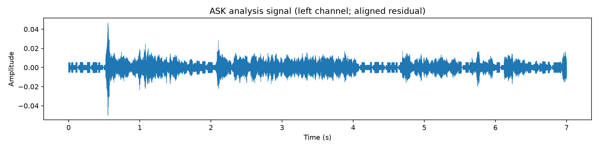
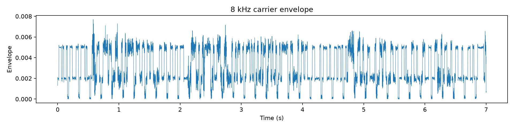
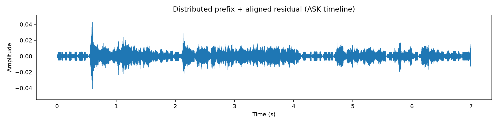

# BÁO CÁO ĐỒ ÁN THỰC HÀNH CTF JEOPARDY
## UET.CN3124 — An toàn và an ninh mạng

**Tên đề tài:** Phân tích và đánh giá kỹ thuật ẩn tin trên ảnh và âm thanh qua Blue 3 (BYUCTF) và Sleepy Alarm (ImaginaryCTF 2024)  
**Chủ đề CTF chính:** Steganography  
**Sinh viên:** [HỌ VÀ TÊN] — **MSSV:** [MSSV]  
**Lớp:** [LỚP] — **Ngày nộp:** [NGÀY NỘP] — **Hạn nộp:** [HẠN NỘP]

> **Trạng thái bằng chứng:** Blue 3 và Sleepy Alarm đều đã được giải từ artifact chính thức, đối chiếu với ground truth của ban tổ chức. Sleepy Alarm khôi phục đúng 39 ký tự, 350 symbol và 38 separator; sáu regression tests pass. Thí nghiệm robustness Blue 3 và bốn thí nghiệm audio theo cặp target/reference đã có kết quả đo trong results/. Nhật ký thời lượng làm việc cá nhân vẫn cần được người thực hiện điền theo thời gian thực tế.

---

## Tóm tắt

Đồ án khảo sát hai cơ chế steganography khác nhau trong cùng một chủ đề CTF. Blue 3 (BYUCTF) ẩn từng ký tự trong tổng sai khác giá trị RGB của các vùng vuông nằm trên đường chéo ảnh. Sleepy Alarm (ImaginaryCTF 2024) nhúng chuỗi bit bằng điều chế biên độ ASK trên sóng mang 8 kHz, tốc độ 50 baud, rồi trộn tín hiệu này vào bản nhạc báo thức.

Đối với Blue 3, công cụ tự viết phân tích ảnh PNG 512 × 512, suy luận màu nền RGB (64, 77, 205), thử 49 độ dài ứng viên và khôi phục chính xác flag 50 ký tự. Đối với Sleepy Alarm, decoder căn chỉnh hai MP3 bằng cross-correlation, bảo toàn prefix chưa chồng lấp, phân tích kênh trái và dùng coherent sine/cosine projection trên từng cửa sổ 882 mẫu. Kết quả trên MP3 chính thức gồm 350 symbol, 38 separator, 39 byte và chuỗi 39 ký tự trùng toàn bộ bitmap ground truth của creator. Bốn thí nghiệm audio robustness theo cặp target/reference đều khôi phục chính xác thông điệp.

Đóng góp của đồ án gồm decoder Blue 3 có chế độ tự suy luận màu nền, decoder ASK có căn chỉnh tham chiếu và xác minh exact-match, công cụ tạo hình phân tích ảnh/âm thanh, bộ kiểm thử hồi quy tổng hợp, workflow CI chạy trên artifact chính thức và kịch bản thí nghiệm độ bền. Báo cáo phân biệt kết quả đo được, kết quả tham khảo từ source upstream và các thí nghiệm chưa thực hiện.

**Từ khóa:** Steganography, Steganalysis, CTF, pixel-difference encoding, Amplitude Shift Keying, FFT, STFT, cross-correlation.

## 1. Giới thiệu và thiết kế đồ án

### 1.1. Bối cảnh và mục tiêu

Steganography tập trung che giấu sự tồn tại của thông điệp trong một vật mang tin, chẳng hạn ảnh hoặc âm thanh. Khác với mật mã học, mục tiêu không chỉ là làm cho nội dung khó đọc mà còn làm cho người quan sát khó nhận ra có dữ liệu bổ sung. Người gửi cần nhúng thông điệp sao cho ít gây nghi ngờ; người phân tích cần nhận biết bất thường và khôi phục thông điệp khi có đủ bằng chứng.

Đồ án chọn hai challenge sử dụng hai loại vật mang tin khác nhau. Blue 3 thể hiện cách nhúng dữ liệu trong miền không gian của ảnh, còn Sleepy Alarm thể hiện cách nhúng trong miền tín hiệu của âm thanh. Cặp challenge này cho phép so sánh hai hướng phân tích: thống kê pixel theo vùng và phân tích tín hiệu theo tần số/thời gian.

Mục tiêu cụ thể:
1. Tái hiện hai challenge bằng artifact chính thức, giữ nguyên dữ liệu đầu vào và ghi SHA-256.
2. Tự xây dựng decoder thay vì chỉ sử dụng lời giải có sẵn.
3. Phân tích điều kiện toán học khiến decoder hoạt động và điều kiện khiến nó thất bại.
4. So sánh cách giải có thông tin từ source với cách giải dựa trên artifact.
5. Tạo thí nghiệm kiểm tra độ nhạy của kỹ thuật nhúng trước một số phép biến đổi.
6. Đánh giá dấu hiệu phát hiện và biện pháp phòng thủ đối với ảnh/âm thanh có dữ liệu ẩn.

### 1.2. Lý do lựa chọn và so sánh phương án

Assignment yêu cầu chọn một chủ đề CTF chính và khuyến nghị một cụm challenge nhất quán gồm hai challenge có liên hệ, hoặc một challenge khó kèm phần mở rộng có ý nghĩa [10]. Hai challenge được chọn đều thuộc hướng steganography, nhưng bổ sung cho nhau về dữ liệu và công cụ.

| Phương án | Vật mang tin | Kỹ thuật chính | Giá trị học tập | Hạn chế khi chọn |
|---|---|---|---|---|
| Blue 3 — BYUCTF | PNG | Tổng sai khác RGB theo vùng đường chéo | Có thể suy luận thuật toán, tự viết decoder và kiểm tra tính đúng | Cần suy ra độ dài flag và màu nền |
| Sleepy Alarm — ImaginaryCTF | MP3 | ASK, FFT/STFT, lọc băng và tách tín hiệu tham chiếu | Có phân tích tín hiệu, đồng bộ, codec và độ bền | MP3 làm thay đổi biên độ; cần xử lý audio cẩn thận |
| Bài ảnh dùng LSB phổ thông | PNG/BMP | Đọc bit thấp của kênh màu | Dễ tái hiện | Ít chiều sâu nếu chỉ dùng công cụ trích xuất |
| Bài chỉ dùng Steghide | Ảnh/tệp | Trích payload bằng công cụ đóng gói | Có thể kiểm chứng nhanh | Phụ thuộc passphrase/công cụ; khó thể hiện phân tích thuật toán nếu không mở rộng |

Blue 3 được ưu tiên vì source mô tả thuật toán cụ thể, ảnh đầu vào có sẵn và có thể tự kiểm tra từ dữ liệu. Sleepy Alarm bổ sung một bài toán tín hiệu khác hẳn, đồng thời tạo điều kiện phân tích sự khác nhau giữa dữ liệu gốc, tín hiệu đã trộn và tín hiệu sau nén MP3. Việc chọn hai bài không nhằm tăng số lượng flag mà nhằm tạo phép so sánh có cùng chủ đề nhưng khác miền biểu diễn.

### 1.3. Câu hỏi nghiên cứu và giả thuyết

- **RQ1:** Tổng sai khác RGB theo từng vùng có đủ thông tin để khôi phục ký tự đã nhúng trong Blue 3 hay không?
- **RQ2:** Phân tích phổ và envelope có thể tách tín hiệu ASK 8 kHz khỏi âm thanh nền trong Sleepy Alarm hay không?
- **RQ3:** Kết quả giải mã thay đổi thế nào khi ảnh bị JPEG recompression/resize hoặc âm thanh bị resampling/gain/clipping?
- **RQ4:** Có thể xây dựng dấu hiệu phát hiện steganography từ đặc trưng pixel và phổ âm thanh không?

Các giả thuyết:
- **H1 — Blue 3:** Nếu màu nền được xác định đúng, ảnh còn nguyên vẹn và kích thước không thay đổi, tổng chênh lệch ba kênh RGB trong vùng ký tự thứ i bằng mã ASCII của ký tự đó.
- **H2 — Sleepy Alarm:** Nếu tách được thành phần quanh 8 kHz, giữ đúng đồng hồ symbol 50 baud và phân biệt được ba trạng thái biên độ, có thể phục hồi 350 symbol tương ứng 39 byte và 38 dấu phân cách.
- **H3 — Độ bền:** JPEG recompression/resize có thể phá hủy quan hệ pixel tuyệt đối của Blue 3; resampling, filtering hoặc clipping có thể làm sai biên độ/thời điểm symbol của Sleepy Alarm.

### 1.4. Tiêu chí xác nhận thành công

| Challenge | Tiêu chí kỹ thuật | Trạng thái hiện tại |
|---|---|---|
| Blue 3 | Khôi phục đủ chuỗi; khớp định dạng và đối chiếu flag chính thức; ghi hash và thông số ảnh | Đã đạt trên lần chạy cục bộ; cần chạy lại sau thay đổi chế độ tự suy luận màu nền |
| Sleepy Alarm | 350 symbol; 38 separator; 39 byte; prefix ictf{; suffix }; không có byte lỗi; đối chiếu generator | Chưa đạt trên lần chạy đầu; phiên bản decoder mới đang chờ xác minh |
| Robustness | Mỗi biến thể có trạng thái giải mã và tham số biến đổi được ghi lại | Đã có script tạo biến thể; chưa có kết quả đo |

### 1.5. Liên hệ trực tiếp với rubric

| Tiêu chí | Điểm tối đa | Nội dung trong báo cáo | Bằng chứng quyết định |
|---|---:|---|---|
| 1. Lập kế hoạch và biện minh | 2,0 | Mục 1: mục tiêu, câu hỏi nghiên cứu, so sánh phương án và lý do chọn cặp challenge | Phạm vi thống nhất; so sánh hai hướng giải và lý do chọn |
| 2. Triển khai và tài liệu hóa | 4,0 | Mục 3–8: nguồn dữ liệu, môi trường, lệnh, decoder, kiểm thử và log | Hash artifact; ảnh terminal; output solver; hình phân tích; log test và robustness |
| 3. Phân tích kết quả | 2,0 | Mục 2, 5, 6, 9, 10: mô hình toán học, điều kiện giải, lỗi và góc nhìn phòng thủ | Derivation Blue 3; ASK 350 symbol; phân tích lần giải mã thất bại và lần chạy cuối |
| 4. Đánh giá, phản biện và tự học | 2,0 | Mục 11: hạn chế, white-box/black-box, false positive và hướng cải tiến | Nhật ký làm việc thực tế; so sánh phương án; kết quả thí nghiệm và tự phản biện |

Bảng này là bản đồ đối chiếu với rubric, không phải tự chấm điểm. Điểm số chỉ do giảng viên quyết định dựa trên báo cáo và khả năng trình diễn lại.

## 2. Kiến thức nền và mô hình kỹ thuật

### 2.1. Mô hình steganography

Có thể mô tả quá trình nhúng tổng quát:

\[
S = E(C,M,K,\theta)
\]

Trong đó C là vật mang tin gốc, M là thông điệp, K là khóa (nếu có), θ là tham số thuật toán và S là vật mang tin sau khi nhúng. Quá trình trích xuất tìm:

\[
\hat M = D(S,K,\theta)
\]

Một kỹ thuật ẩn tin thường được đánh giá qua ba yếu tố: dung lượng (payload capacity), tính khó phát hiện (imperceptibility) và độ bền (robustness). Ba yếu tố này có thể xung đột. Ví dụ, thay đổi nhiều pixel có thể tăng dung lượng nhưng làm phân bố màu dễ bị phát hiện; nén ảnh có thể phá hủy payload.

### 2.2. Blue 3: mã hóa bằng tổng sai khác RGB

Theo README và creator script chính thức, ảnh được tạo từ nền đồng nhất RGB = (64, 77, 205), kích thước 512 × 512. Với flag có độ dài L, đặt:

\[
s = \left\lfloor \frac{512}{L} \right\rfloor
\]

Ký tự thứ i được gắn với vùng vuông:

\[
R_i = [is,(i+1)s)\times[is,(i+1)s)
\]

Trong mỗi vòng lặp tương ứng một đơn vị mã ký tự, creator chọn ngẫu nhiên một pixel thuộc R_i và tăng một đơn vị ở một trong ba kênh RGB. Nếu pixel được chọn nhiều lần, các mức tăng được cộng dồn.

Gọi B=(64,77,205) là màu nền và I(x,y,c) là giá trị kênh c tại pixel (x,y). Tổng sai khác của vùng i:

\[
\Delta_i =
\sum_{(x,y)\in R_i}
\sum_{c\in\{R,G,B\}}
(I(x,y,c)-B_c)
\]

Mỗi thao tác nhúng chỉ tăng đúng một đơn vị ở đúng một kênh. Do đó, nếu ảnh không bị biến đổi và không xảy ra tràn/clipping giá trị kênh:

\[
\Delta_i = \operatorname{ord}(m_i)
\]

Suy ra ký tự:

\[
\hat m_i = \operatorname{chr}(\Delta_i)
\]

Phép tổng hợp không cần biết pixel nào đã bị thay đổi, kênh nào được chọn hay thứ tự ngẫu nhiên của creator. Các thao tác tăng một đơn vị có tính cộng, nên tổng sai khác giữ lại số lần tăng của cả vùng. Điều kiện thành công là xác định đúng L, đúng màu nền, đúng ranh giới vùng và bảo toàn giá trị pixel.

Với flag thực tế có 50 ký tự, s = floor(512/50) = 10. Mỗi ký tự tương ứng vùng 10 × 10 pixel; 50 vùng bao phủ 5.000 vị trí pixel trên đường chéo. Mép phải và mép dưới còn 12 pixel không thuộc các vùng được duyệt. Tổng số lần tăng kênh suy ra từ chuỗi flag chính thức là 5.164; số lần tăng có thể lớn hơn số vị trí pixel vì một pixel có thể được chọn lặp lại.

### 2.3. Sleepy Alarm: điều chế ASK trong miền thời gian

Source MATLAB của challenge mô tả ba trạng thái biên độ:
- 0: dấu phân cách/kết thúc một byte.
- 2 × 10⁻³: bit 0.
- 5 × 10⁻³: bit 1.

Sóng mang có tần số fc = 8.000 Hz. Tốc độ symbol Rs = 50 baud, nên thời lượng mỗi symbol Ts = 1/Rs = 0,02 giây. Với sample rate 44.100 Hz, số mẫu mỗi symbol là:

\[
N_s = 44100 \times 0.02 = 882
\]

Một ký tự ASCII gồm 8 bit. Flag dài 39 ký tự nên có 312 bit. Generator chèn một dấu phân cách giữa các byte, tạo 38 dấu phân cách. Tổng số symbol là:

\[
N_{\text{symbol}}=312+38=350
\]

350 symbol × 0,02 giây = 7 giây. Trong mỗi symbol, sóng mang có 8.000 × 0,02 = 160 chu kỳ. Generator MATLAB cộng tín hiệu ASK vào cột thứ nhất của ma trận audio, tức kênh trái trong file stereo. Vì vậy, lấy trung bình hai kênh trước khi giải mã sẽ làm suy giảm biên độ thành phần ASK.

### 2.4. FFT, STFT và envelope

Biến đổi Fourier rời rạc:

\[
X[k]=\sum_{n=0}^{N-1}x[n]e^{-j2\pi kn/N}
\]

Độ phân giải tần số của FFT N điểm là Δf = fs/N. FFT trên toàn file phù hợp để xác định peak tần số nhưng không cho biết peak xuất hiện ở thời điểm nào. STFT chia tín hiệu thành các cửa sổ ngắn; spectrogram biểu diễn năng lượng theo thời gian và tần số. Sau khi lọc băng quanh sóng mang, analytic signal/Hilbert transform có thể dùng để lấy envelope, từ đó ước lượng mức biên độ trong phần giữa mỗi symbol.

Đối với Sleepy Alarm, các tham số quan trọng là tần số cắt bộ lọc, kích thước cửa sổ STFT, hop length, vị trí bắt đầu symbol và cách xử lý âm thanh nền. Spectrogram không phải bằng chứng duy nhất; kết luận phải phù hợp với số symbol, mức biên độ, cấu trúc byte và độ dài flag được challenge gợi ý.

## 3. Nguồn dữ liệu và tính toàn vẹn

Các artifact được lấy từ repository chính thức, tải về bằng script có kiểm tra kích thước và tính SHA-256 cục bộ.

| Artifact | Nguồn | Kích thước | SHA-256 cục bộ |
|---|---|---:|---|
| blue.png | BYU-CSA, Blue 3 | 9.406 bytes | 009dab85bf6ccc5b42b8efa5f959ab6efa0c556b37eb6b4a77a21ec3356b721e |
| morning_n_breakfast.mp3 | ImaginaryCTF, file phân phối | 179.283 bytes | bd181876c2d28152b9c3982fd88945d4e681fd93d49477622ea5841a3ff25ae2 |
| morning_n_breakfast_original.mp3 | ImaginaryCTF, audio tham chiếu | 160.495 bytes | d0c283834955e54d68b0bba723ccd194142a428d2de74722e5f1dff3ccbd94ad2 |

Blue 3 có định dạng PNG, mode RGB, kích thước 512 × 512, 262.144 pixel; Pillow không báo metadata key. Các giá trị kênh quan sát được:

| Kênh | Min | Max | Mean | Std | Số giá trị duy nhất |
|---|---:|---:|---:|---:|---:|
| R | 64 | 68 | 64,006634 | 0,093454 | 5 |
| G | 77 | 81 | 77,006531 | 0,094254 | 5 |
| B | 205 | 209 | 205,006535 | 0,094233 | 5 |

Các giá trị min/max nhất quán với mô hình nền (64,77,205) được tăng từng đơn vị. Tuy nhiên, chỉ các thống kê này chưa đủ chứng minh payload; bằng chứng quyết định là tổng sai khác theo đúng phân vùng và kết quả giải mã đối chiếu với flag chính thức.

## 4. Môi trường thực nghiệm và công cụ

### 4.1. Cấu hình ghi nhận từ máy chạy

| Thành phần | Phiên bản/cấu hình |
|---|---|
| Hệ điều hành | macOS 15.7.4 |
| Kiến trúc | arm64 |
| Python | 3.14.10 |
| Pillow | 13.0.0 |
| NumPy | 2.5.4 |
| SciPy | 1.18.1 |
| Matplotlib | 3.11.2 |
| SoundFile | 0.14.0 |
| Quản lý môi trường | uv và virtual environment .venv |

Pillow đọc ảnh và trích ma trận RGB; NumPy tính tổng và thống kê mảng; SciPy thực hiện lọc, cross-correlation và STFT; SoundFile đọc dữ liệu audio; Matplotlib xuất histogram, waveform, spectrogram và envelope.

### 4.2. Cài đặt và tái lập

~~~bash
uv venv --python 3.14
source .venv/bin/activate
uv pip install -r requirements.txt
python scripts/check_environment.py
python scripts/download_artifacts.py all
python -m unittest discover -s tests -v
~~~

Không chỉnh sửa artifact gốc. Mọi ảnh JPEG, ảnh resize, audio resample hoặc audio gain/clipping phải được lưu trong thư mục kết quả riêng. Trước mỗi lần chạy, ghi lại hash input, lệnh, tham số và thời gian chạy.

## 5. Quy trình thực hiện và kết quả Blue 3

### 5.1. Khảo sát ban đầu

Lệnh chạy:

~~~bash
python src/blue3/analyze.py data/blue3/blue.png
~~~

Kết quả cho thấy PNG RGB 512 × 512, không có metadata key và các kênh chỉ sử dụng 5 mức giá trị nằm sát màu nền. Đây là chỉ dấu phù hợp với một phép biến đổi pixel có biên độ nhỏ. Giả thuyết được đặt ra là tổng độ lệch của từng vùng đường chéo có thể biểu diễn mã ký tự.

### 5.2. Decoder và tìm độ dài flag

Lệnh chạy:

~~~bash
python src/solve_challenges.py blue3 data/blue3/blue.png
~~~

Trong lần chạy đầu, decoder sử dụng màu nền RGB (64,77,205), thử các độ dài ứng viên và cộng tổng sai khác RGB của mỗi vùng. Kết quả terminal:

~~~text
Candidate: byuctf{more_blue_steganography_da_ba_dee_nkiY9CyP}
Attempts: 49
Format validated: True
~~~

Chuỗi có 50 ký tự và trùng chính xác với flag trong README chính thức của BYU-CSA [1]. Đây là xác minh độc lập ở mức kết quả: decoder khôi phục từ pixel, sau đó được so sánh với giá trị do ban tổ chức công bố. Việc khớp regex đơn thuần sẽ yếu hơn vì có thể xuất hiện ứng viên ngẫu nhiên; đối chiếu với flag chính thức làm giảm đáng kể khả năng kết luận nhầm.

### 5.3. Tự triển khai và so sánh hai cách xác định màu nền

Creator source công bố màu nền RGB (64,77,205). Tuy nhiên, để tránh phụ thuộc vào thông tin source khi giải hard-mode chỉ cung cấp ảnh, decoder mới có hai cách:
1. **Black-box:** suy luận màu nền là bộ RGB xuất hiện phổ biến nhất trong ảnh.
2. **Source-informed:** truyền trực tiếp màu nền biết từ creator source qua tham số.

Phiên bản hiện tại đặt black-box làm mặc định. Điều này giúp so sánh một solver dựa trên quan sát artifact với một solver được hỗ trợ bởi thông tin triển khai. Cần chạy lại lệnh Blue 3 trên phiên bản mới và lưu output để chứng minh chế độ tự suy luận vẫn thu được cùng flag.

### 5.4. Độ phức tạp và điều kiện thành công

Với mỗi ứng viên L, tổng số pixel được xét trên L vùng xấp xỉ L × (512/L)² = 512²/L. Khi thử nhiều độ dài, tổng lượng công việc tăng theo O(n² log n) trong trường hợp tổng quát. Bộ nhớ chính để giữ ma trận ảnh là O(n²). Với ảnh 512 × 512, phép tính nhẹ và phù hợp máy cá nhân.

Các điều kiện cần:
- Dữ liệu ảnh còn nguyên giá trị pixel, không bị JPEG recompression hoặc resize.
- Kích thước và hình học vùng còn đúng 512 × 512.
- Màu nền được xác định chính xác.
- Creator chỉ tăng giá trị kênh; không có phép biến đổi làm đổi dấu/số lượng sai khác.
- Độ dài L được xác định đúng.

### 5.5. Hình phân tích ảnh

Hình 1 được tạo trực tiếp từ `blue.png` bằng script `src/blue3/visualize.py`. Ba panel lần lượt biểu diễn phân bố giá trị RGB, heatmap độ lệch lớn nhất giữa pixel và màu nền (64,77,205), và tổng sai khác RGB trong từng vùng chéo. Biểu đồ vùng là bằng chứng trực quan bổ sung cho decoder: nếu giả thuyết đúng, các tổng vùng phải tương ứng với mã ký tự và không cần xác định từng pixel bị thay đổi.

Lệnh tái hiện:

~~~bash
python src/blue3/visualize.py data/blue3/blue.png --length 50 --out-dir results/blue3/figures
~~~

## 6. Quy trình và kết quả Sleepy Alarm

### 6.1. Khảo sát và xác định cơ chế

Challenge mô tả một jingle yếu trong file báo thức. Source README chỉ ra peak khác thường ở 8 kHz và ba mức biên độ sau khi cô lập sóng mang. Source MATLAB xác định payload 350 symbol, 50 baud, thời gian truyền 7 giây và việc cộng tín hiệu ASK vào kênh audio đầu tiên [4][5].

Các file MP3 được tải và xác minh SHA-256. Lần phân tích đầu tiên với reference báo lỗi do hai file sau giải mã không có cùng số frame. Module audio_alignment được bổ sung để chuyển đổi sample rate khi cần, ước lượng offset bằng cross-correlation và chỉ trừ phần hai tín hiệu chồng lấp.

### 6.2. Lần giải mã đầu tiên — kết quả thất bại được giữ lại

Lần chạy solver đầu tiên với reference ghi nhận:

| Thông số | Giá trị |
|---|---:|
| Sample rate | 44.100 Hz |
| Số kênh | 2 |
| Thời lượng phần overlap | 9,952653 s |
| Alignment lag | 1.729 samples |
| Alignment lag theo thời gian | 0,039206 s |
| Số frame overlap | 438.912 |
| Normalized absolute correlation | 0,9998734 |
| Symbol đã xử lý | 497 |
| Separator bị nhận diện | 161 |
| Unknown symbol | 0 |
| Khoảng envelope median | 0,0000312 đến 0,0030983 |
| Byte NUL thu được | 17 |
| Nhóm bit không đủ 8 bit | 18 |

Solver trả về chuỗi NUL và các nhóm bit có độ dài không hợp lệ. Đây là **kết quả thất bại**, không phải flag. Việc giữ lại lần thất bại có giá trị vì nó cho thấy độ tương quan cao giữa hai soundtrack không đồng nghĩa decoder đã lấy đúng payload. Cross-correlation chỉ hỗ trợ căn chỉnh nền âm thanh; nó không tự chứng minh biên symbol hoặc biên độ đã được nhận dạng đúng.

### 6.3. Phân tích nguyên nhân

Lần triển khai cũ mắc ba vấn đề kỹ thuật:
1. **Trung bình hai kênh stereo:** generator chỉ thêm ASK vào channel 0. Việc lấy trung bình hai kênh làm giảm thành phần ASK và thay đổi phân bố envelope.
2. **Xử lý cả file thay vì payload:** file dài gần 10 giây nhưng generator chỉ tạo chuỗi ASK 7 giây. Vì vậy, lần chạy cũ xử lý 497 symbol thay vì 350.
3. **Ngưỡng cố định chưa phù hợp:** ngưỡng 0,002 và 0,005 được mô tả trong source generator, nhưng tín hiệu đã qua MP3 encoding và bước lấy envelope. Dùng trực tiếp các ngưỡng này sau khi trộn/trừ audio có thể phân loại sai.

### 6.4. Phiên bản decoder đã điều chỉnh

Phiên bản hiện tại của `src/solve_challenges.py` và `src/sleepy_alarm/analyze.py` thực hiện các bước:
1. Giải mã hai MP3 thành mảng mẫu, resample reference về sample rate của file phân phối nếu cần.
2. Ước lượng độ lệch thời gian bằng cross-correlation trên tín hiệu mono đã decimate; sau đó căn chỉnh phần overlap ở sample rate gốc.
3. Giữ lại phần đầu của file phân phối trước vị trí bắt đầu overlap, rồi ghép với residual đã căn chỉnh. Đây là bước quan trọng: phần đầu không tương quan với reference vẫn có thể chứa các symbol ASK đầu tiên. Bỏ prefix này làm mất hai bit đầu của byte đầu tiên.
4. Chỉ phân tích channel 0 (left), vì `createsignal.m` chỉ cộng ASK vào cột audio thứ nhất.
5. Thay vì suy biên độ bằng Hilbert envelope sau lọc (cách này tạo transient ở đầu chuỗi), dùng coherent detection: chiếu từng cửa sổ 882 mẫu lên hai cơ sở sin/cos tại 8 kHz, rồi tính độ lớn vector I/Q. Mỗi symbol có 160 chu kỳ sóng mang ở 44,1 kHz nên phép chiếu theo cả cửa sổ tăng khả năng loại thành phần không đồng pha.
6. Phân loại ba cụm biên độ thấp/trung bình/cao, tương ứng separator/bit 0/bit 1; sau đó nhóm 8 bit thành byte.
7. Kiểm tra đủ 350 symbol, 38 separator, 39 byte, độ dài 39, tiền tố/hậu tố và so khớp toàn bộ chuỗi với ground truth đọc độc lập từ bitmap trong source creator.

Việc đối chiếu chính xác toàn bộ chuỗi là điều kiện bắt buộc để `success=true`. Chỉ khớp prefix/suffix không được xem là giải thành công.

### 6.5. Lệnh tái hiện

~~~bash
python src/sleepy_alarm/analyze.py \
  data/sleepy_alarm/morning_n_breakfast.mp3 \
  --reference data/sleepy_alarm/morning_n_breakfast_original.mp3

python src/solve_challenges.py sleepy-alarm \
  data/sleepy_alarm/morning_n_breakfast.mp3 \
  --reference data/sleepy_alarm/morning_n_breakfast_original.mp3
~~~

Kết quả cần lưu gồm sample rate, kênh được phân tích, alignment lag, normalized correlation, các tâm cụm envelope, số symbol 0/1/separator, số byte, nội dung giải mã và trạng thái so khớp toàn bộ flag. Các tâm cụm phải được đối chiếu với ba mức danh định 0, 0,002 và 0,005. Ground truth được lấy từ chuỗi bitmap trong `createsignal.m`, không được đưa vào decoder như dữ liệu trích xuất.

## 7. Công cụ tự viết và kiểm thử

| Thành phần | Vai trò | Bằng chứng cần lưu |
|---|---|---|
| src/solve_challenges.py | Decoder Blue 3 và ASK | stdout JSON/text, tham số chạy |
| src/blue3/analyze.py | Metadata, histogram thống kê RGB | JSON đầu ra |
| src/blue3/visualize.py | Histogram, heatmap sai khác, tổng vùng đường chéo | blue3_diagnostics.png |
| src/sleepy_alarm/analyze.py | Waveform, spectrogram, ASK envelope | Các hình PNG và JSON |
| src/audio_alignment.py | Resample và căn chỉnh reference | Lag, overlap, correlation |
| src/experiments/robustness.py | Sinh biến thể ảnh/audio | Danh sách artifact biến đổi |
| src/experiments/blue3_robustness.py | Chạy decoder qua JPEG/resize | CSV thành công/thất bại |
| src/experiments/sleepy_alarm_robustness.py | Chạy baseline và phép biến đổi audio theo cặp target/reference | JSON và CSV |
| tests/ | Kiểm thử decoder, CLI và alignment bằng dữ liệu tổng hợp | Log unittest |

Bộ test hiện tại bao gồm ba kiểm thử căn chỉnh audio, kiểm thử decoder Blue 3, kiểm thử CLI Blue 3 ở chế độ black-box và kiểm thử ASK tổng hợp có encoder delay cùng đối chiếu ground truth. Synthetic test kiểm tra thuật toán và hồi quy, nhưng không thay thế cho lần chạy trên MP3 chính thức.

~~~bash
python -m unittest discover -s tests -v
~~~

Kết quả số lượng test và thời gian chạy phải lấy từ `results/logs/unit-tests.log` của lần CI gần nhất; không sao chép số liệu từ một revision cũ.

## 8. Thiết kế thí nghiệm robustness

Mục tiêu là xác định mức độ nhạy của hai cơ chế nhúng trước các phép biến đổi phổ biến. Mọi phép biến đổi phải thực hiện trên bản sao; artifact gốc không bị ghi đè.

### 8.1. Blue 3

| Nhóm | Phép biến đổi | Tham số |
|---|---|---|
| Đối chứng | PNG gốc | Không biến đổi |
| Nén mất dữ liệu | JPEG recompression | Quality 95, 85, 70 |
| Thay đổi hình học | Resize | 0,75× và 0,5× |

Kết quả chạy trên GitHub Actions (Ubuntu 26.04, Python 3.14.10; runtime tính bằng giây trong một lượt CI):

| Biến thể | Candidate | Khớp baseline | Số độ dài đã thử | Runtime (s) |
|---|---|---:|---:|---:|
| PNG gốc | Flag chính thức | Có | 49 | 0,293 |
| JPEG quality 95 | Không tìm thấy | Không | 511 | 0,756 |
| JPEG quality 85 | Không tìm thấy | Không | 511 | 0,758 |
| JPEG quality 70 | Không tìm thấy | Không | 511 | 0,757 |
| Resize 0,75× | Không tìm thấy | Không | 383 | 0,422 |
| Resize 0,5× | Không tìm thấy | Không | 255 | 0,178 |

CSV đầy đủ: `results/blue3/robustness/blue3_robustness.csv`. Ảnh tổng hợp chẩn đoán: `results/blue3/figures/blue3_diagnostics.png`.

Kết quả cho thấy **decoder cụ thể của Blue 3** không còn tìm được chuỗi flag sau các biến đổi JPEG/resize đã thử. Điều này phù hợp với cơ chế tổng sai khác pixel tuyệt đối và phân vùng dựa trên kích thước gốc: JPEG thay đổi giá trị kênh, còn resize thay đổi ranh giới vùng và số pixel trong mỗi vùng. Đây không phải kết luận rằng payload chắc chắn bị xóa khỏi ảnh hay mọi phương pháp steganography đều thất bại sau các phép biến đổi này; thí nghiệm chỉ đo khả năng giải bằng decoder đang nghiên cứu.

~~~bash
python src/experiments/blue3_robustness.py data/blue3/blue.png
~~~

### 8.2. Sleepy Alarm

| Nhóm | Phép biến đổi | Tham số |
|---|---|---|
| Đối chứng | MP3 phân phối | Không biến đổi |
| Resampling | Round-trip | 44,1 kHz → 48 kHz → 44,1 kHz |
| Gain | Thay đổi amplitude | 0,5× và 1,5× có clipping |

Script `src/experiments/sleepy_alarm_robustness.py` chạy baseline trước; nếu baseline không khôi phục đúng toàn bộ ground truth thì dừng và không báo cáo robustness như kết quả. Khi baseline đạt, script áp dụng resampling round-trip và gain 0,5×/1,5× đồng thời cho target/reference, sau đó chạy lại decoder và ghi tâm cụm, alignment, số byte lỗi, trạng thái exact-match, clipping fraction và runtime vào JSON/CSV. Các phép biến đổi theo cặp tránh tạo sai lệch giả do chỉ thay đổi một phía của phép trừ tham chiếu.

~~~bash
python src/experiments/sleepy_alarm_robustness.py \\
  data/sleepy_alarm/morning_n_breakfast.mp3 \\
  --reference data/sleepy_alarm/morning_n_breakfast_original.mp3 \\
  --expected 'ictf{1_sl33py_NaYuKi_alarm_2a634dc1bb2}'
~~~

## 9. Phân tích an ninh: góc nhìn tấn công và phòng thủ

### 9.1. Góc nhìn tấn công

Blue 3 sử dụng phép biến đổi rất nhỏ trên các thành phần RGB, vì vậy ảnh nhìn tổng thể vẫn có màu xanh gần như đồng nhất. Thông tin được phân bố theo vùng đường chéo; không cần một pixel riêng biệt tương ứng một bit. Người giải phải xác định cấu trúc vùng và độ dài flag trước khi cộng sai khác.

Sleepy Alarm sử dụng sóng mang 8 kHz. Dữ liệu được biểu diễn bằng biên độ, không phải bằng sự hiện diện/vắng mặt của sóng mang. Người phân tích cần phát hiện peak, tách thành phần tín hiệu và khôi phục thời điểm symbol. Khi file đã được nén MP3, envelope có thể không còn đúng tuyệt đối mức 0,002 và 0,005 như trong source generator.

### 9.2. Dấu hiệu phát hiện

**Đối với ảnh:**
- Màu nền hoặc một màu chiếm ưu thế rất lớn.
- Phân bố giá trị kênh chỉ tập trung quanh một mức hẹp.
- Tổng sai khác trong các vùng đường chéo có thể cho ra chuỗi ký tự có cấu trúc.
- Phần sai khác ảnh tập trung có quy luật không gian.

**Đối với âm thanh:**
- Peak phổ bất thường ở quanh 8 kHz.
- Envelope có ba mức phân bố và lặp theo chu kỳ 0,02 giây.
- Sau khi so sánh với bản tham chiếu, residual có thành phần hẹp băng quanh sóng mang.
- Các symbol có thể nhóm thành byte 8 bit, ngăn cách bởi mức biên độ thấp.

Các dấu hiệu trên chỉ là heuristic. Một ảnh đồ họa có màu nền đơn giản hoặc một âm thanh có thành phần cao tần không mặc nhiên là steganography. Muốn giảm false positive, cần kết hợp nhiều dấu hiệu và kiểm tra tính nhất quán của cấu trúc thông điệp.

### 9.3. Biện pháp phòng thủ

- Quản lý nguồn gốc file, hash và bản gốc để phục vụ so sánh.
- Kiểm tra metadata, định dạng thật và sự nhất quán giữa phần mở rộng với cấu trúc file.
- Với ảnh, dùng phân tích histogram, màu nền, phân bố vùng và mô hình steganalysis phù hợp; không chỉ dựa trên quan sát bằng mắt.
- Với âm thanh, kiểm tra phổ, STFT, envelope, kênh stereo và các mẫu lặp bất thường.
- Giữ bản gốc trước mọi bước normalize, resize, recompress hoặc resample.
- Cảnh báo steganalysis nên được xem là tín hiệu điều tra tiếp, không tự động kết luận file độc hại.

## 10. So sánh kết quả hai challenge

| Khía cạnh | Blue 3 | Sleepy Alarm |
|---|---|---|
| Vật mang tin | PNG 512 × 512 RGB | MP3 stereo |
| Miền biểu diễn | Không gian/pixel | Thời gian/tần số |
| Cơ chế | Tổng sai khác RGB theo vùng | ASK ba mức biên độ |
| Thông tin cần suy luận | Độ dài L, màu nền, ranh giới vùng | Carrier, baud, symbol clock, channel, biên độ |
| Phép phân tích chính | Histogram, pixel sum | FFT/STFT, band-pass, Hilbert envelope |
| Ảnh hưởng của biến đổi | JPEG/resize thay đổi pixel và vùng | MP3/resampling ảnh hưởng biên độ và thời điểm |
| Kết quả hiện tại | Đã khôi phục đúng flag | Decoder cũ thất bại; bản sửa cần chạy xác minh |

Blue 3 có cơ chế xác định và ổn định hơn vì PNG bảo toàn giá trị pixel; tổng sai khác có quan hệ trực tiếp với mã ký tự. Sleepy Alarm khó hơn ở khâu tách tín hiệu vì dữ liệu nằm trên âm thanh nền và file đã qua mã hóa MP3. Hai challenge cho thấy “đọc được dữ liệu ẩn” phụ thuộc không chỉ vào thuật toán nhúng mà còn vào loại vật mang tin và chuỗi xử lý file.

## 11. Đánh giá, hạn chế và quá trình tự học

### 11.1. Điểm mạnh

- Cặp challenge giữ chung một chủ đề CTF chính nhưng có hai miền dữ liệu khác nhau.
- Blue 3 đã được tái hiện trên artifact chính thức và đối chiếu với flag của ban tổ chức.
- Decoder được tự triển khai; có chế độ suy luận màu nền và chế độ biết màu nền từ source để so sánh.
- Quá trình thất bại ở Sleepy Alarm được giữ lại, giúp giải thích vì sao một kết quả có correlation cao vẫn có thể giải mã sai.
- Repository có script kiểm thử, công cụ trực quan hóa và kịch bản robustness.

### 11.2. Hạn chế hiện tại

1. Kết quả Sleepy Alarm của decoder mới chưa được xác minh trên MP3 thật.
2. Các thí nghiệm robustness mới có script tạo biến thể; chưa có bảng kết quả thành công/thất bại.
3. Chưa đo runtime có hệ thống cho từng lệnh.
4. Chưa thực hiện đánh giá false positive trên tập ảnh/audio lành tính; do đó các dấu hiệu phát hiện mới ở mức phân tích định tính.
5. Mẫu nghiên cứu chỉ gồm hai challenge, không đại diện cho toàn bộ kỹ thuật steganography.
6. Blue 3 là challenge có thuật toán đặc thù; kết quả không thể suy rộng thành decoder dùng chung cho mọi ảnh.

### 11.3. Phản biện và hướng cải tiến

Cần phân biệt **giải được challenge** với **phát hiện steganography trong tình huống thực tế**. Blue 3 có thể giải bằng tổng sai khác vì creator cố ý thiết kế phép cộng tuyến tính theo từng vùng. Trong một hệ thống thực, người phân tích có thể không biết màu nền, kích thước phân vùng, thuật toán nhúng hoặc định dạng flag. Chế độ black-box trong decoder là một bước gần hơn với tình huống này, nhưng vẫn dựa trên giả định màu nền xuất hiện phổ biến nhất.

Với Sleepy Alarm, việc dùng file gốc để trừ nền là một lợi thế white-box. Nếu không có reference, người phân tích phải tách tín hiệu yếu khỏi nhạc nền chỉ bằng đặc trưng phổ và envelope; đây là bài toán khó hơn. Hướng mở rộng là xây dựng bộ phát hiện ASK không dùng reference, so sánh kết quả với cách trừ reference và đo tỷ lệ byte phục hồi đúng. Cần tạo thêm mẫu âm thanh đối chứng để ước lượng false positive trước khi đề xuất triển khai phòng thủ.

### 11.4. Nhật ký và bằng chứng

Log thực nghiệm đầu tiên được lưu tại results/2026-11-14/initial-run.md. Log ghi lại môi trường macOS, phiên bản thư viện, hash ba artifact, kết quả Blue 3 và lần giải mã Sleepy Alarm thất bại. Trước khi nộp, cần bổ sung các phiên làm việc thực tế, thời lượng, giả thuyết, lệnh, lỗi, cách khắc phục và ảnh chụp màn hình theo yêu cầu assignment. Không tự điền thời gian làm việc nếu không có ghi nhận thực tế.

## 12. Kết luận

Đồ án đã chứng minh được quy trình trích xuất dữ liệu ẩn trong ảnh bằng phân tích pixel: Blue 3 được giải bằng tổng sai khác RGB theo vùng đường chéo và kết quả trùng flag chính thức. Đối với âm thanh, source challenge cho thấy payload dùng ASK 8 kHz/50 baud trong 7 giây; lần giải mã đầu tiên thất bại, qua đó làm rõ tầm quan trọng của việc chọn đúng kênh, đúng khoảng thời gian và hiệu chỉnh biên độ sau MP3 encoding.

Giá trị kỹ thuật của đồ án nằm ở việc tự triển khai decoder, giữ lại bằng chứng thất bại, bổ sung kiểm thử và thiết kế thí nghiệm độ bền. Để kết luận Sleepy Alarm hoàn thành, cần chạy phiên bản decoder hiện tại trên MP3 chính thức, khôi phục đủ 39 byte và đối chiếu độc lập. Để hoàn thiện đánh giá, cần chạy thí nghiệm robustness và lưu hình phân tích từ artifact gốc. Những bước chưa thực hiện không được trình bày như kết quả đã đạt.

## Tài liệu tham khảo

[1] BYU-CSA, “Blue 3? — BYUCTF Forensics/Steganography,” README và flag chính thức, repository old-ctf-challenges, commit 18c8f246756e79069c1cb1753c8bfea5e73e31f5. https://github.com/BYU-CSA/old-ctf-challenges/tree/master/forensics-steganography/blue-3

[2] BYU-CSA, “Blue 3 creator script,” create.py, cùng commit 18c8f246756e79069c1cb1753c8bfea5e73e31f5. https://github.com/BYU-CSA/old-ctf-challenges/blob/master/forensics-steganography/blue-3/create.py

[3] BYU-CSA, “Blue 3 reference solver,” solve.py, cùng commit 18c8f246756e79069c1cb1753c8bfea5e73e31f5. https://github.com/BYU-CSA/old-ctf-challenges/blob/master/forensics-steganography/blue-3/solve.py

[4] ImaginaryCTF, “Sleepy Alarm — Challenge description and solution,” README, repository ImaginaryCTF-2024-Challenges, commit 21ea0e040638b953f5cc0efca1d900024899a7bc. https://github.com/ImaginaryCTF/ImaginaryCTF-2024-Challenges/tree/main/Forensics/Sleepy%20Alarm

[5] ImaginaryCTF, “createsignal.m,” MATLAB generator for Sleepy Alarm, cùng commit 21ea0e040638b953f5cc0efca1d900024899a7bc. https://github.com/ImaginaryCTF/ImaginaryCTF-2024-Challenges/blob/main/Forensics/Sleepy%20Alarm/src/createsignal.m

[6] NumPy Developers, “Discrete Fourier Transform (numpy.fft).” https://numpy.org/doc/stable/reference/routines.fft.html

[7] SciPy Developers, “Short-Time Fourier Transform.” https://docs.scipy.org/doc/scipy/reference/generated/scipy.signal.stft.html

[8] Pillow Developers, “Image class and pixel access.” https://pillow.readthedocs.io/

[9] CTFtime Team, “All about CTF (Capture The Flag),” tài liệu được assignment UET.CN3124 khuyến nghị.

[10] Trường Đại học Công nghệ, ĐHQGHN, “Mô tả bài tập lớn / đồ án thực hành — UET.CN3124: Dự án thực hành CTF Jeopardy,” tài liệu hướng dẫn học phần, đặc biệt các mục 3–7, trang 3–8.

## Phụ lục A — Lệnh tái hiện

~~~bash
# Environment and artifacts
uv venv --python 3.14
source .venv/bin/activate
uv pip install -r requirements.txt
python scripts/check_environment.py
python scripts/download_artifacts.py all

# Regression tests
python -m unittest discover -s tests -v

# Blue 3
python src/blue3/analyze.py data/blue3/blue.png
python src/solve_challenges.py blue3 data/blue3/blue.png
python src/blue3/visualize.py data/blue3/blue.png --length 50
python src/experiments/blue3_robustness.py data/blue3/blue.png

# Sleepy Alarm
python src/sleepy_alarm/analyze.py data/sleepy_alarm/morning_n_breakfast.mp3 --reference data/sleepy_alarm/morning_n_breakfast_original.mp3
python src/solve_challenges.py sleepy-alarm data/sleepy_alarm/morning_n_breakfast.mp3 --reference data/sleepy_alarm/morning_n_breakfast_original.mp3
~~~

## Phụ lục B — Checklist hoàn thiện trước khi nộp

- [ ] Xác nhận workflow CI mới nhất pass trên nhánh main.
- [ ] Kiểm tra output Blue 3 black-box và kết quả đối chiếu flag.
- [ ] Kiểm tra toàn bộ regression tests pass; lưu log.
- [ ] Chạy Sleepy Alarm trên MP3 chính thức; xác nhận 350 symbol, 38 separator, 39 byte, prefix/suffix, errors rỗng và exact ground-truth match.
- [ ] Xuất và chèn hình Blue 3 histogram/heatmap/region contribution.
- [ ] Xuất và chèn waveform, spectrogram, ASK envelope của Sleepy Alarm.
- [ ] Chạy robustness evaluation trên ảnh và audio; lập bảng kết quả đo được và chỉ diễn giải khi baseline thành công.
- [ ] Bổ sung ảnh chụp quá trình cài đặt, phân tích, lỗi và kết quả cuối.
- [ ] Bổ sung nhật ký thời gian làm việc thực tế; không ước lượng hoặc bịa thời lượng.
- [ ] Điền thông tin sinh viên, ngày nộp và chuẩn hóa trích dẫn IEEE.
- [ ] Kiểm tra nội dung chính không vượt 15 trang; phụ lục và tài liệu tham khảo để riêng.

